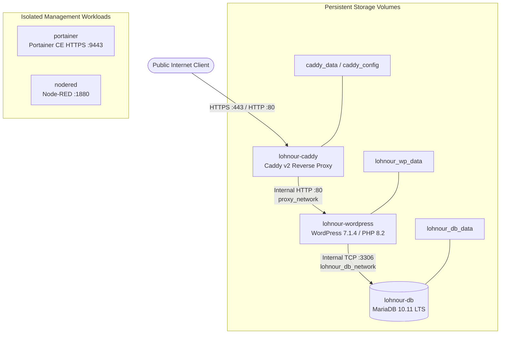

# LOHNOUR PRO

[](https://github.com/tanu268/Lohnour/actions/workflows/ci.yml)
[](https://pro.lohnour.com)
[](https://wordpress.org)
[](https://mariadb.org)
[](https://caddyserver.com)
[](https://cloud.oracle.com)

**LOHNOUR PRO** is an enterprise-grade AI upskilling, training, and strategic advisory platform. This repository houses the complete application source code, WordPress custom child theme, custom CMS plugins, reproducible local container specifications, and canonical production infrastructure configuration for Sam's Oracle Cloud VM.

---

## 1. Production Architecture Overview

The live production application runs on a dedicated Oracle Cloud Infrastructure (OCI) Compute Instance (`sams-oracle-vm`, `141.148.51.166`) powered by Oracle Linux Server 9.7 ARM64 (`aarch64`).



### Core Architecture Highlights

- **Single Ingress Point:** Official ARM64 Caddy (`caddy@sha256:78bd35025...`) binds to host ports 80 and 443 with automated Let's Encrypt TLS termination.
- **Strict Private Isolation:** MariaDB (port 3306) and WordPress Apache (port 80) publish **zero** host ports. All inter-container communication occurs across isolated Docker bridge networks (`lohnour_db_network`, `proxy_network`).
- **Persistent Volume Separation:** Application data resides entirely in dedicated Docker volumes (`lohnour_wp_data`, `lohnour_db_data`), decoupled from ephemeral container layers.
- **Strict Zero-Trust Management:** Portainer and Node-RED management interfaces are filtered at the host firewall level (`firewalld`).

---

## 2. Technology Stack

| Layer | Component | Specification |
|---|---|---|
| **Host OS** | Oracle Linux Server 9.7 | Kernel `6.12.0-201.74.2.2.el9uek.aarch64` |
| **Container Engine** | Docker Engine & Compose | Docker `v29.5.0` / Compose `v5.1.3` |
| **Reverse Proxy** | Caddy v2 LTS (ARM64) | Digest `sha256:78bd35025c7ba85961dd149ae670315129954e77abe2383ac47c89106b35ade9` |
| **Web Server** | Apache 2.4 | Bundled with official WordPress PHP 8.2 image |
| **Application Runtime**| PHP 8.2 / WordPress 7.1.4 | DB Revision `61833`, 512M upload/memory limits |
| **Database** | MariaDB 10.11 LTS | Digest `sha256:0de9840f23463c22eb4892d9bfd63086367e4bffe9b68ff4b62621d6eced854c` |
| **Active Theme** | Twenty Twenty-Five Child | Located in `current source/lohnourpro_wp_theme` |
| **Custom CMS** | Lohnour Program CMS | Custom post types & module navigation plugin in `current source/lohnour-program-cms` |

---

## 3. Repository Structure

```text
Lohnour/
├── .github/
│   └── workflows/
│       └── ci.yml                          # Continuous Integration workflow
├── .env.example                            # Safe development & production environment template
├── .gitignore                              # Comprehensive multi-developer ignore rules
├── CONTRIBUTING.md                         # Multi-developer Git workflow, branching & PR guidelines
├── README.md                               # Project master documentation
├── docker-compose.yml                      # Canonical production Docker Compose stack (ARM64)
├── docker-compose.local.yml                # Reproducible local development Docker Compose stack
├── Caddyfile                               # Canonical production Caddyfile (Reverse proxy & TLS)
├── Dockerfile                              # Custom WordPress application Docker buildfile
├── config/
│   └── uploads.ini                         # PHP runtime memory & upload limit tuning
├── infrastructure/                         # Canonical mirrored infrastructure definitions
│   ├── docker-compose.yml
│   ├── docker-compose.local.yml
│   ├── Caddyfile
│   └── config/uploads.ini
├── docs/                                   # Authoritative architectural and operational runbooks
│   ├── DEVELOPMENT_SETUP.md                # Step-by-step local developer onboarding guide
│   ├── DEPLOYMENT_GUIDE.md                 # Production deployment runbook for Oracle Cloud VM
│   ├── ROLLBACK_GUIDE.md                   # Comprehensive failure recovery and rollback procedures
│   ├── PRODUCTION_ARCHITECTURE.md          # Deep dive into network topology, volumes & security
│   ├── DATABASE_BACKUP_RESTORE.md          # Live MariaDB backup and restoration runbook
│   ├── ENVIRONMENT_VARIABLES.md            # Complete reference for all configuration variables
│   ├── GITHUB_WORKFLOW.md                  # Multi-developer branch model & release lifecycle
│   ├── GITHUB_PRODUCTION_RECONCILIATION.md # Three-way forensic reconciliation audit
│   └── GITHUB_FINAL_EXECUTION_REPORT.md    # Master verification and execution report
├── scripts/                                # Production recovery, verification, and audit automation
│   ├── audit_container_health.py
│   ├── audit_database_integrity.py
│   ├── phase8_backup.sh
│   ├── phase10_db_recovery.sh
│   ├── phase11_file_recovery.sh
│   └── phase12_portainer_deploy.sh
└── current source/
    ├── lohnourpro_wp_theme/                # Active Twenty Twenty-Five Child WordPress theme
    ├── lohnour-program-cms/                # Custom WordPress CMS plugin for programs & pathways
    └── LohnourPro_Migration/               # Migration assets, legacy references, and helper scripts
```

---

## 4. Quick Start — Local Development

Developers can run the full WordPress application locally without needing Oracle Cloud access:

### Prerequisites

- [Docker Desktop](https://www.docker.com/products/docker-desktop/) (Windows with WSL2 backend or macOS)
- [Git](https://git-scm.com/)

### Step 1: Clone the Repository

```bash
git clone https://github.com/tanu268/Lohnour.git
cd Lohnour
git checkout developer
```

### Step 2: Configure Local Environment

Copy `.env.example` to `.env` and set local passwords:

```bash
cp .env.example .env
```

Ensure the following variables are defined for local development:

```ini
LOCAL_DB_NAME=lohnour_local_wp
LOCAL_DB_USER=lohnour_local_user
LOCAL_DB_PASSWORD=LocalSecurePassword123!
LOCAL_DB_ROOT_PASSWORD=LocalRootPassword123!
```

### Step 3: Launch Local Docker Stack

```bash
docker compose -f docker-compose.local.yml up -d
```

### Step 4: Access Local Application

- **WordPress Frontend:** [http://localhost:8080](http://localhost:8080)
- **WordPress Admin:** [http://localhost:8080/wp-admin](http://localhost:8080/wp-admin)

The local stack automatically mounts `./current source/lohnourpro_wp_theme` into `/var/www/html/wp-content/themes/twentytwentyfive-child`, enabling live theme editing.

For detailed onboarding instructions, seed data imports, and troubleshooting, read [docs/DEVELOPMENT_SETUP.md](docs/DEVELOPMENT_SETUP.md).

---

## 5. Multi-Developer Git Workflow

We employ a structured Git flow model:

- `main` — Production-ready, stable releases.
- `developer` — Active integration and staging branch. All feature branches merge here.
- `feature/*` — New feature work (e.g., `feature/contact-form-validation`).
- `fix/*` — Bug fixes (e.g., `fix/hero-mobile-spacing`).
- `hotfix/*` — Urgent production fixes branched directly from `main`.

See [CONTRIBUTING.md](CONTRIBUTING.md) and [docs/GITHUB_WORKFLOW.md](docs/GITHUB_WORKFLOW.md) for full branch conventions, commit standards, and pull request guidelines.

---

## 6. Production Deployment & Security

Deployments to Sam's Oracle VM are strictly controlled and fail-closed:

- **Controlled Execution:** Deployments are executed via version-controlled scripts with pre-flight checks and automatic checkpoint generation.
- **Rollback Readiness:** Every deployment is preceded by a point-in-time snapshot of the database and volume archives.
- **Zero Live Ingress Mutation:** Ingress, database, and container changes are governed by the procedures documented in [docs/DEPLOYMENT_GUIDE.md](docs/DEPLOYMENT_GUIDE.md) and [docs/ROLLBACK_GUIDE.md](docs/ROLLBACK_GUIDE.md).

---

## 7. Documentation Index

| Guide | Description |
|---|---|
| [DEVELOPMENT_SETUP.md](docs/DEVELOPMENT_SETUP.md) | Comprehensive local development, database seeding, and theme setup |
| [DEPLOYMENT_GUIDE.md](docs/DEPLOYMENT_GUIDE.md) | Production deployment runbook for Oracle Cloud VM |
| [ROLLBACK_GUIDE.md](docs/ROLLBACK_GUIDE.md) | Emergency rollback procedures and volume restoration steps |
| [PRODUCTION_ARCHITECTURE.md](docs/PRODUCTION_ARCHITECTURE.md) | Technical architecture, container specs, network topology, and volumes |
| [DATABASE_BACKUP_RESTORE.md](docs/DATABASE_BACKUP_RESTORE.md) | MariaDB backup, point-in-time recovery, and data verification |
| [ENVIRONMENT_VARIABLES.md](docs/ENVIRONMENT_VARIABLES.md) | Variable definitions, production vs local configuration, secret handling |
| [GITHUB_WORKFLOW.md](docs/GITHUB_WORKFLOW.md) | Branching strategy, review standards, and CI/CD integration |
| [GITHUB_PRODUCTION_RECONCILIATION.md](docs/GITHUB_PRODUCTION_RECONCILIATION.md) | Three-way audit between Local, GitHub, and Oracle VM |
| [GITHUB_FINAL_EXECUTION_REPORT.md](docs/GITHUB_FINAL_EXECUTION_REPORT.md) | Master forensic execution report with all 32 evidence items |

---

## 8. License & Proprietary Notice

Copyright © 2026 Lohnour Pro. All rights reserved. Proprietary software.
