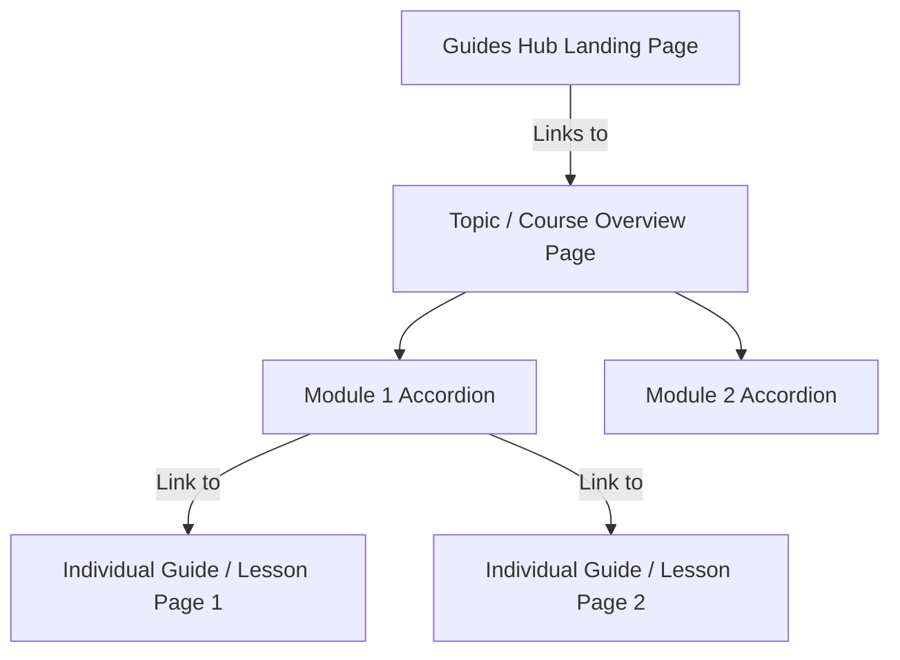

# Guides Hub Specifications & Requirements

This document captures the detailed design, structural architecture, and UI/UX requirements for the new **Guides Hub** on the Lohnour Pro website. These requirements are transcribed directly from user instructions and serve as the definitive specification for implementation.

> [!IMPORTANT]
> This document is for architectural and design reference only. Do not execute any implementation steps (coding or database changes) until explicitly instructed by the user.

---

## 1. Hub Concept & Business Goal
*   **A Standalone Experience:** The Guides Hub must function as a self-contained hub, independent of the main marketing website (similar to the Blog Hub). A user should be able to land in the Guides Hub and browse courses/lessons seamlessly without needing to interact with the rest of the corporate site.
*   **Business Conversion:** The primary goal of the Guides Hub is conversion—turning casual website visitors and readers into premium customers through high-quality, structured learning content.

---

## 2. Content & Domain Taxonomy
The system must support courses covering multiple domains.
*   **Sectors (Custom Taxonomy - `guide_sector`):** Broad domains or learning pathways (equivalent to Blog Categories).
    *   *Examples:* Artificial Intelligence (AI), Content Marketing, Soft Skills, Cloud Computing.
*   **Sub-categories / Tags:** Finer tags/sub-categories under each domain (equivalent to Blog Tags).
    *   *Examples (under AI):* Agentic AI, Generative AI.

---

## 3. Structural Architecture (Topic overview with Lesson Links)
The Guides Hub uses a **hybrid 3-level structure** that avoids separate pages for Modules, but keeps lesson content cleanly separated onto individual pages:

### Level 1: Topic / Course Page (Udemy Course Preview Style)
*   **Definition:** The landing/overview page for a specific course or topic (e.g., *How to build your own content agent using Claude and n8n*).
*   **UI Layout (Udemy Course Preview):** Unlike a standard blog post, this page serves as a course catalog page:
    *   **Introduction:** High-level details of the course (syllabus, target audience, overview).
    *   **Intro Video:** A preview video representing the course.
    *   **Modules List (Accordions):** Groupings of related lessons (e.g. *Module 1: Set-up*, *Module 2: Getting Started*) rendered as accordions.
    *   **Links:** Expanding a module accordion reveals a list of text links pointing to the individual lesson pages.

### Level 2: Modules (Purely Accordion Containers)
*   **Definition:** Logical groupings of related lessons inside the Topic page.
*   *Note: Modules do not have their own separate pages or archives.*

### Level 3: Individual Guides (Blog Single Mirror + TOC)
*   **Definition:** The actual step-by-step lesson/guide page (e.g., *What is an AI Agent?*, *Setting up LangChain*).
*   **Access:** Accessed via links inside the Module accordions on the Topic overview page.
*   **UI Layout (Blog Single Mirror):** Extremely similar to the single blog post page (clean reading layout) but with the following additions:
    *   **Lesson Video:** Features the dedicated lesson video.
    *   **Sidebar (Right):** Custom Table of Contents (TOC) with scroll-spy highlighting the active section.
    *   **Navigation:** Next and Previous buttons at the bottom of the content to go to adjacent lessons.
