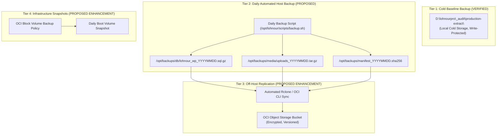
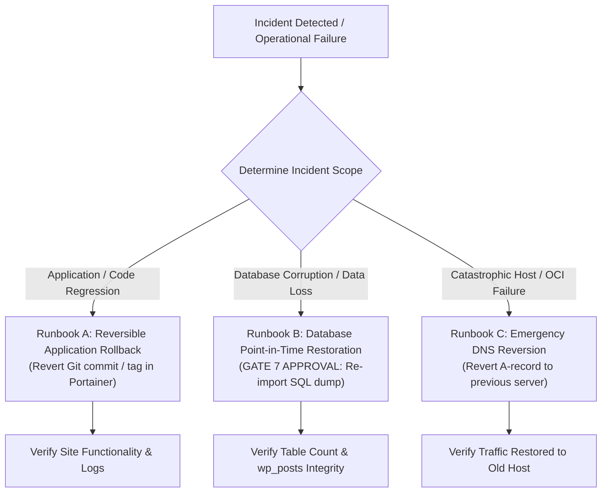

# LOHNOUR PRO — BACKUP, RESTORATION & DISASTER ROLLBACK SPECIFICATION

**Document Identifier:** `BACKUP_AND_ROLLBACK.md`  
**Date:** 2026-11-06  
**Auditor / Role:** Lead DevOps Engineer & Infrastructure Security Reviewer  
**Target Environment:** Sam's Oracle VM (Oracle Linux 9.7)  
**Operating Mode:** STRICT READ-ONLY FORENSICS — ZERO MUTATIONS EXECUTED  
**Canonical Documentation Path:** `D:\lohnourpro\docs\BACKUP_AND_ROLLBACK.md`  
*(Note: Duplicate copies existing in `current source/lohnourpro_wp_theme/my-docs/` are historical theme artifacts and remain untouched).*  
**Status:** **AUTHORITATIVE BASELINE VERIFIED — PROCEDURES DEFINED**

---

## 1. Executive Summary

This document specifies the authoritative backup baseline, production backup automation, and step-by-step rollback runbooks for **Lohnour Pro** on **Sam's Oracle VM**.

### Core Data Safety Principles:
1. **Preservation of Existing & Newly Created Data:** The default rollback procedure is designed to preserve persistent Docker volumes (`lohnour_wp_data`, `lohnour_db_data`). Reverting application code does not automatically reverse database mutations.
2. **Strict Separation of Application Rollback vs Data Rollback:** Application errors are resolved by reverting container versions, Git commits on the `developer` branch, or configuration files while leaving database records and media files intact.
3. **Staging vs Production Storage Isolation & Retention Policy (BLOCKER 1 & C RESOLUTION):**
   - Staging restore drills (Gate 6 — Stage 3) must strictly utilize dedicated staging volume `lohnour_db_staging_data`.
   - Staging tests must **NEVER** mount, reference, or restore data into the production database volume `lohnour_db_data`.
   - **Routine Deletion Forbidden:** Routine deletion of `lohnour_db_staging_data` via `docker volume rm` is strictly removed from standard restore-drill procedures.
   - **Retention & Purpose:** Staging volume `lohnour_db_staging_data` is classified as a **`retained staging reference`** following a successful validation drill. It must NOT be described as immutable, as Docker named volumes possess no native cryptographic write-locking or immutability enforcement mechanism.
   - **Ownership & Storage:** Staging volume data is owned natively by the MariaDB process (`UID 999:GID 999`) and consumes ~25–50 MB within the host's Docker Root Dir (which must be budgeted against host disk limits).
   - **Deletion Governance:** Any future decommissioning or removal of `lohnour_db_staging_data` requires explicit authorization under **GATE 10** (`Volume Deletion & Emergency Reset Operations Approval`).
   - Production database restoration into `lohnour_db_data` is a separate, destructive operation requiring explicit Founder authorization under **GATE 7**.
4. **Distinct Disaster Recovery Procedures & Atomic Backup Set (BLOCKER 9 & B RESOLUTION):**
   - **Atomic Backup Set Rule:** The production database dump and WordPress media uploads archive constitute a single, indivisible backup set. If either required component fails, is missing, or fails integrity verification, the entire backup set is invalid and the process must abort with an error exit code. A successful run must NEVER be reported when a required component is missing.
   - **Manifest Generation & Verification:** Every backup run must generate and cryptographically verify a SHA-256 checksum manifest (`manifest_${DATE}.sha256`) identifying all required components in the backup set.
   - **Retention Pruning Gate:** Pruning of historical backups occurs strictly AFTER every required component in the current backup set passes all integrity tests and manifest verification.
   - **Host Permissions & Initial Directory Creation:** Accessing Docker named volumes within `/var/lib/docker/volumes/...` requires execution with root / sudo privileges on Oracle Linux (as `/var/lib/docker/` is owned by `root:root` with mode `0710`). The backup destination `/opt/backups` must be provisioned during host initialization with restrictive root-controlled permissions via `sudo mkdir -p /opt/backups/db /opt/backups/media && sudo chown -R root:root /opt/backups && sudo chmod 700 /opt/backups` (avoiding any recursive `opc:opc` ownership to prevent unprivileged access to sensitive database dumps).
   - **Signal & Exit Trap Handling & Concurrency Locking:** The backup script must install a comprehensive cleanup trap (`EXIT INT TERM HUP`) covering the entire execution lifecycle to ensure partial database dumps, partial media archives, and temporary credentials are unconditionally purged upon any abnormal termination. The script must also acquire an exclusive lock via `flock` to prevent concurrent or overlapping executions.
   - **`--single-transaction` Limitation:** Operators must recognize that `--single-transaction` provides ACID snapshot consistency only for transactional InnoDB tables; it does not lock nontransactional tables (MyISAM, MEMORY) or prevent schema inconsistencies from concurrent DDL statements.
   - Disaster recovery operations are categorized into four distinct, non-interchangeable procedures with independent statuses:
     - **Procedure 1: Backup Creation** (Capturing transactional database dump and media archives — `PROPOSED REFERENCE SPECIFICATION — NOT TESTED`).
     - **Procedure 2: Backup Integrity Verification** (Cryptographic SHA-256 matching, non-empty size validation, manifest generation, and archive decompression tests `gzip -t` / `tar -tzf` — `PROPOSED REFERENCE SPECIFICATION — NOT TESTED`).
     - **Procedure 3: Restore Validation Drill** (Dry-run import into isolated staging container and volume `lohnour_db_staging_data` under Gate 6 Stage 3 — `PENDING VERIFICATION`).
     - **Procedure 4: Production Rollback** (Operational reversion of container versions/commits under Runbook A, or destructive database point-in-time recovery into `lohnour_db_data` under Gate 7 Runbook B — `PROPOSED — NOT TESTED IN PRODUCTION`).
5. **Zero Credential Exposure:** Database administrative commands must never pass plaintext passwords in command-line flags. All scripts must utilize secured client option files (`--defaults-extra-file` with mode `0600`).
6. **Untested Status & No Guarantees:** All rollback runbooks and scripts represent proposed reference specifications and have **NOT BEEN TESTED IN PRODUCTION**. Empirical drill validation in an isolated staging environment is required before production deployment. No claims of guaranteed recovery, guaranteed rollback, or 100% non-destructive execution are made.

---

## 2. Authoritative Backup Inventory (Local Baseline)

The authoritative pre-deployment backup resides exclusively on the local administrative machine at:  
`D:\lohnourpro\_audit\production-extract\`

All artifacts have been cryptographically verified against the master manifest `manifest-all.sha256`:

```
Algorithm: SHA-256
Location: D:\lohnourpro\_audit\production-extract\
```

| Component | Path / Filename | Size (Bytes) | SHA-256 Checksum | Verified Contents & Status |
| :--- | :--- | :---: | :--- | :--- |
| **Database Dump** | `database/production-lohnour_wp.sql` | 290,627 | `db8628e7743b133e372265a7d09ac29729ab7f7c8ed9dfcd0bdd257d7e88a880` | Local file presence and SHA-256 hash verified (`VERIFIED — CURRENT`). Dump inspection verified: exactly 14 tables (12 WordPress core + 2 Sendinblue/Brevo plugin tables; db_version: 61833; target: lohnour_wp; prefix: wp_). |
| **Media Uploads** | `uploads.tar.gz` | 59,733,182 | `5001b5d43159e4611540661d8af50a9fd0301e06a4224587cb38f7f68983b0d9` | Local file presence and SHA-256 hash verified (`VERIFIED — CURRENT`). Detailed extraction contents unverified in production. |
| **Child Theme** | `twentytwentyfive-child.tar.gz` | 6,229,809 | `a14af7f749f0e459b60658514e79325a29a3bb7fdc98c56d9591e1faadca802d` | Local file presence and SHA-256 hash verified (`VERIFIED — CURRENT`). Complete child theme archive. |
| **Plugin Suite** | `lohnour_all_plugins.tar.gz` | 5,646,919 | `1e2c4bb948ea06621a52b1911b6d6a29868695798d8e37753454643e0be68484` | Local file presence and SHA-256 hash verified (`VERIFIED — CURRENT`). All plugin files. |
| **Program CMS** | `lohnour_program_cms.tar.gz` | 18,777 | `b6807f7c19c5cbbfe028c24949fbbe8fca65dc2f8da8be5b7a14ec84869a842b` | Local file presence and SHA-256 hash verified (`VERIFIED — CURRENT`). Standalone custom plugin. |
| **PHP Config** | `config/uploads.ini` | 119 | `8f8f90dd0d2ff804e84b72ef35b8cf0f214ceb3664d6dbdb9db5d4a13d7890ec` | Local file presence and SHA-256 hash verified (`VERIFIED — CURRENT`). Runtime limits. |
| **WP Config** | `config/wp-config.redacted.php` | 5,922 | `c53a6704ebf9a3ea77c15e8e8334f68a2bf6cb8e3678fe0168be80608796853c` | Local file presence and SHA-256 hash verified (`VERIFIED — CURRENT`). Redacted configuration. |

---

## 3. Four-Tier Backup Architecture



### 3.1 Tier 1: Local Cold Baseline (`VERIFIED`)
- Maintained permanently in `D:\lohnourpro\_audit\production-extract\`.
- Acts as the offline recovery baseline if host-level backups are corrupted.

### 3.2 Tier 2: Automated Daily Host Backup Reference Script

> [!WARNING]
> **OPERATIONAL STATUS: `PROPOSED REFERENCE SPECIFICATION — NOT TESTED IN PRODUCTION — AUTOMATED SCHEDULING (CRON/TIMERS) DISABLED`**  
> This script is a proposed reference specification for daily host-level backups. Automated scheduling via `cron` or systemd timers is strictly disabled until the script is empirically validated in an isolated staging test environment and explicitly authorized by the Founder.

#### Operational & Failure Handling Requirements:
1. **Initial Provisioning & Execution Privileges:** Accessing Docker volume mountpoints (`/var/lib/docker/volumes/...`) requires root execution on Oracle Linux (Docker Root Dir has mode `0710` owned by `root:root`). The script must be executed with root privileges (`sudo /opt/lohnour/scripts/backup.sh`). Initial backup directory structure must be provisioned during host setup with restrictive root ownership and permissions:
   ```bash
   sudo mkdir -p /opt/backups/db /opt/backups/media
   sudo chown -R root:root /opt/backups
   sudo chmod 700 /opt/backups
   ```
   *Security Standard:* Unnecessary recursive ownership changes to `opc:opc` are strictly prohibited. Backup archives contain sensitive database credentials and production user data; `/opt/backups` must remain strictly restricted to `root:root` with mode `700` (`rwx------`).
2. **Concurrency Locking (`flock`):** The script must acquire an exclusive file lock (`flock -n`) on `/var/run/lohnour_backup.lock` before executing. If another backup process or manual run is already active, subsequent executions terminate immediately without collision.
3. **Signal & EXIT Trap Lifecycle:** A persistent cleanup trap must handle `EXIT INT TERM HUP`. If the script terminates prematurely, receives a termination signal, or encounters an error before full verification, all partial dumps, partial media archives, and temporary credentials must be purged immediately, and the file lock released.
4. **Bounded Database Readiness Probe:** Before initiating `mariadb-dump`, a bounded database readiness probe (`mariadb-admin ping` with a 20-second timeout) must confirm MariaDB is ready to accept queries.
5. **Atomic Backup Set Rule:** The database dump and WordPress media uploads archive constitute a single, indivisible backup set. If either component fails or is missing, the entire backup terminates with exit code 1.
6. **Manifest Generation & Verification:** A SHA-256 manifest identifying all backup set components must be generated and verified (`sha256sum -c`) before reporting completion.
7. **Integrity Validation Before Retention Pruning:** Historical backups older than 7 days are pruned strictly AFTER every component of the current backup set passes all integrity verification tests and manifest verification.

```bash
#!/usr/bin/env bash
set -euo pipefail

BACKUP_DIR="/opt/backups"
DATE=$(date +%Y%m%d_%H%M%S)
DB_CNF="/etc/lohnour/db_backup.cnf"
DB_CONTAINER="lohnour-db"
MIN_FREE_KB=1048576 # 1 GB minimum free disk space
BACKUP_SUCCESS=0
LOCK_FILE="/var/run/lohnour_backup.lock"

DB_DUMP_FILE="${BACKUP_DIR}/db/lohnour_wp_${DATE}.sql.gz"
MEDIA_ARCHIVE_FILE="${BACKUP_DIR}/media/uploads_${DATE}.tar.gz"
MANIFEST_FILE="${BACKUP_DIR}/manifest_${DATE}.sha256"

# --- CONCURRENCY LOCK ACQUISITION ---
exec 200>"${LOCK_FILE}"
if ! flock -n 200; then
  echo "[$(date -Iseconds)] FATAL: Another backup process holds lock ${LOCK_FILE}. Aborting." >&2
  exit 1
fi

# --- COMPREHENSIVE SIGNAL & EXIT CLEANUP TRAP ---
cleanup() {
  local exit_code=$?
  # Clean container option file if present
  docker exec "${DB_CONTAINER}" rm -f /tmp/db_backup.cnf 2>/dev/null || true

  if [ "${BACKUP_SUCCESS}" -ne 1 ]; then
    echo "[$(date -Iseconds)] FATAL: Backup process aborted or failed (Exit Code: ${exit_code}). Purging partial backup set artifacts..." >&2
    [ -n "${DB_DUMP_FILE:-}" ] && rm -f "${DB_DUMP_FILE}"
    [ -n "${MEDIA_ARCHIVE_FILE:-}" ] && rm -f "${MEDIA_ARCHIVE_FILE}"
    [ -n "${MANIFEST_FILE:-}" ] && rm -f "${MANIFEST_FILE}"
    echo "[$(date -Iseconds)] Incomplete backup artifacts purged. Zero partial backups retained." >&2
  fi

  # Release concurrency lock
  flock -u 200 2>/dev/null || true
}
trap cleanup EXIT INT TERM HUP

echo "[$(date -Iseconds)] Starting Lohnour Tier 2 atomic backup run..."

# --- PREFLIGHT CHECKS & PREREQUISITES ---
# 1. Verify backup directories exist and enforce root:root 700 permissions
if [ ! -d "${BACKUP_DIR}/db" ] || [ ! -d "${BACKUP_DIR}/media" ]; then
  mkdir -p "${BACKUP_DIR}/db" "${BACKUP_DIR}/media"
  chown -R root:root "${BACKUP_DIR}"
  chmod 700 "${BACKUP_DIR}"
fi

# 2. Verify client option file exists and is restricted to 0600
if [ ! -f "${DB_CNF}" ]; then
  echo "FATAL: Database credential file ${DB_CNF} not found. Aborting backup." >&2
  exit 1
fi
CNF_PERMS=$(stat -c "%a" "${DB_CNF}" 2>/dev/null || echo "000")
if [ "${CNF_PERMS}" != "600" ]; then
  echo "FATAL: Insecure permissions (${CNF_PERMS}) on ${DB_CNF}. Must be 0600. Aborting." >&2
  exit 1
fi

# 3. Verify target database container is running
DB_RUNNING=$(docker inspect -f '{{.State.Running}}' "${DB_CONTAINER}" 2>/dev/null || echo "false")
if [ "${DB_RUNNING}" != "true" ]; then
  echo "FATAL: Container ${DB_CONTAINER} is not running. Aborting database backup." >&2
  exit 1
fi

# 4. Verify destination filesystem has sufficient free space (> 1 GB)
AVAIL_KB=$(df -k --output=avail "${BACKUP_DIR}" | tail -n 1 | tr -d ' ')
if [ "${AVAIL_KB}" -lt "${MIN_FREE_KB}" ]; then
  echo "FATAL: Insufficient storage space on ${BACKUP_DIR} (${AVAIL_KB} KB available, required ${MIN_FREE_KB} KB). Aborting." >&2
  exit 1
fi

# 5. Copy option file to container and set strict permissions
docker cp "${DB_CNF}" "${DB_CONTAINER}:/tmp/db_backup.cnf"
docker exec "${DB_CONTAINER}" chmod 600 /tmp/db_backup.cnf

# 6. Bounded Database Readiness Probe (10 attempts, 2-second interval)
PING_SUCCESS=0
for i in {1..10}; do
  if docker exec "${DB_CONTAINER}" mariadb-admin --defaults-extra-file=/tmp/db_backup.cnf ping --silent 2>/dev/null; then
    PING_SUCCESS=1
    break
  fi
  sleep 2
done

if [ "${PING_SUCCESS}" -ne 1 ]; then
  echo "FATAL: Database failed bounded readiness probe before dump. Aborting." >&2
  exit 1
fi

# --- COMPONENT 1: CONSISTENT DATABASE DUMP & INTEGRITY VALIDATION ---
echo "[$(date -Iseconds)] Executing consistent database dump via mariadb-dump..."
# Note: --single-transaction ensures ACID snapshot consistency for InnoDB tables only.
if ! docker exec "${DB_CONTAINER}" mariadb-dump \
  --defaults-extra-file=/tmp/db_backup.cnf \
  --single-transaction \
  --quick \
  --routines \
  --triggers \
  lohnour_wp | gzip -9 > "${DB_DUMP_FILE}"; then
  echo "FATAL: mariadb-dump pipeline failed. Aborting." >&2
  exit 1
fi

# Clean container option file immediately after dump
docker exec "${DB_CONTAINER}" rm -f /tmp/db_backup.cnf 2>/dev/null || true

# Validate database dump file is non-empty (> 1000 bytes)
DUMP_SIZE=$(stat -c %s "${DB_DUMP_FILE}" 2>/dev/null || echo 0)
if [ ! -s "${DB_DUMP_FILE}" ] || [ "${DUMP_SIZE}" -lt 1000 ]; then
  echo "FATAL: Database dump file is empty or suspiciously small (${DUMP_SIZE} bytes). Aborting." >&2
  exit 1
fi

# Validate gzip archive integrity
if ! gzip -t "${DB_DUMP_FILE}"; then
  echo "FATAL: Database dump archive failed gzip integrity test. Aborting." >&2
  exit 1
fi
echo "[$(date -Iseconds)] Component 1 (Database) successfully verified: ${DB_DUMP_FILE}"

# --- COMPONENT 2: FULL MEDIA UPLOADS ARCHIVE & INTEGRITY VALIDATION ---
WP_DATA_DIR=$(docker volume inspect lohnour_wp_data --format '{{ .Mountpoint }}' 2>/dev/null || echo "")

if [ -z "${WP_DATA_DIR}" ] || [ ! -d "${WP_DATA_DIR}/wp-content/uploads" ]; then
  echo "FATAL: WordPress uploads directory missing or volume unmounted. Media backup is mandatory. Aborting." >&2
  exit 1
fi

echo "[$(date -Iseconds)] Creating media archive from ${WP_DATA_DIR}/wp-content/uploads..."
if ! tar -czf "${MEDIA_ARCHIVE_FILE}" -C "${WP_DATA_DIR}/wp-content" uploads; then
  echo "FATAL: Media archive creation failed. Aborting." >&2
  exit 1
fi

# Validate tar archive integrity
if ! tar -tzf "${MEDIA_ARCHIVE_FILE}" >/dev/null 2>&1; then
  echo "FATAL: Media archive corrupted; failed tar integrity test. Aborting." >&2
  exit 1
fi
echo "[$(date -Iseconds)] Component 2 (Media) successfully verified: ${MEDIA_ARCHIVE_FILE}"

# --- COMPONENT 3: GENERATE & VERIFY UNIFIED BACKUP SET MANIFEST ---
echo "[$(date -Iseconds)] Generating unified backup set manifest: ${MANIFEST_FILE}..."
(
  cd "${BACKUP_DIR}"
  sha256sum "db/lohnour_wp_${DATE}.sql.gz" "media/uploads_${DATE}.tar.gz" > "${MANIFEST_FILE}"
)

if [ ! -s "${MANIFEST_FILE}" ]; then
  echo "FATAL: Failed to generate backup set manifest. Aborting." >&2
  exit 1
fi

# Verify manifest matches generated artifacts
if ! (cd "${BACKUP_DIR}" && sha256sum -c "${MANIFEST_FILE}" >/dev/null 2>&1); then
  echo "FATAL: Backup manifest verification failed. Aborting." >&2
  exit 1
fi
echo "[$(date -Iseconds)] Backup set manifest verified: ${MANIFEST_FILE}"

# Mark backup run as successful (disarms failure cleanup trap)
BACKUP_SUCCESS=1

# --- COMPONENT 4: RETENTION POLICY PRUNING (7 DAYS) ---
# Retention pruning executes strictly AFTER every component in current set passes all integrity tests
find "${BACKUP_DIR}/db" -type f -name "*.sql.gz" -mtime +7 -delete
find "${BACKUP_DIR}/media" -type f -name "*.tar.gz" -mtime +7 -delete
find "${BACKUP_DIR}" -maxdepth 1 -type f -name "manifest_*.sha256" -mtime +7 -delete

echo "[$(date -Iseconds)] Tier 2 atomic backup set (Database + Media + Manifest) completed and verified successfully."
```

### 3.3 Phase 8 Pre-Deployment Host & Workload Baseline Backup Script (`EXECUTED & VERIFIED`)

> [!IMPORTANT]
> **OPERATIONAL STATUS: `EXECUTED & VERIFIED — PHASE 8 CLOSED`**  
> This script is the hardened, canonical Phase 8 pre-deployment backup script certified and successfully executed on Sam's live Oracle VM (`141.148.51.166`) on November 7, 2026 (`2026-11-07T04:46:30Z`). It created the verified production recovery point at `/opt/lohnour/backups/phase8_20261107_044630`. All checksums were verified 100% (`BACKUP_VERIFIED`) and both Portainer and Node-RED were restored and verified healthy and running (HTTP 200). Canonical executable file: [`scripts/phase8_backup.sh`](file:///d:/lohnourpro/scripts/phase8_backup.sh) (SHA-256: `a5b4c44efc7e254a8a04c8f53fb8a0847301ce6fbf1d874531309f476cad9056`). Full execution report: [`docs/PHASE_8_PRODUCTION_HOST_BACKUP_REPORT.md`](file:///d:/lohnourpro/docs/PHASE_8_PRODUCTION_HOST_BACKUP_REPORT.md).

```bash
#!/usr/bin/env bash
# ==============================================================================
# PROPOSED — NOT EXECUTED
# LOHNOUR PRO — PHASE 8: PRODUCTION HOST PRE-DEPLOYMENT BACKUP SCRIPT
# Target: Sam's Oracle VM (141.148.51.166) | Execution: ROOT ONLY
# Canonical Version: Phase 7 Final Closure
# ==============================================================================
set -euo pipefail

# 1. Root Privilege Gate & Secure Umask
if [ "$(id -u)" -ne 0 ]; then
    echo "FATAL: Pre-deployment backup script must be executed as root (e.g. sudo bash $0)." >&2
    exit 1
fi
umask 077

TARGET_PORTAINER="${TARGET_PORTAINER:-portainer}"
TARGET_PORTAINER_VOL="${TARGET_PORTAINER_VOL:-portainer_data}"
TARGET_NODERED="${TARGET_NODERED:-nodered}"
TARGET_NODERED_VOL="${TARGET_NODERED_VOL:-nodered_data}"

BACKUP_TIMESTAMP=$(date +%Y%m%d_%H%M%S)
BACKUP_DIR="${BACKUP_DIR:-/opt/lohnour/backups/phase8_${BACKUP_TIMESTAMP}}"
mkdir -p "${BACKUP_DIR}"
chmod 700 "${BACKUP_DIR}"

# 2. Storage Preflight Check (1,500 MB minimum required)
MIN_REQUIRED_MB=1500
AVAIL_MB=$(df -m -P "${BACKUP_DIR}" | awk 'NR==2 {print $4}')
if [ "${AVAIL_MB}" -lt "${MIN_REQUIRED_MB}" ]; then
    echo "FATAL: Insufficient disk space on ${BACKUP_DIR}. Available: ${AVAIL_MB} MB, Required: ${MIN_REQUIRED_MB} MB. Aborting." >&2
    exit 1
fi

# 3. State Tracking Flags & Exit Trap Handler
PORTAINER_STOPPED_BY_SCRIPT=0
NODERED_PAUSED_BY_SCRIPT=0
BACKUP_SUCCESSFUL=0
CLEANUP_FAILED=0
FINAL_STATUS="BACKUP_INCOMPLETE"

MANIFEST="${BACKUP_DIR}/BACKUP_MANIFEST.txt"
echo "==============================================================================" > "${MANIFEST}"
echo "LOHNOUR PRO — PHASE 8 PRODUCTION PRE-DEPLOYMENT BACKUP MANIFEST" >> "${MANIFEST}"
echo "Timestamp:           $(date -Iseconds)" >> "${MANIFEST}"
echo "Host:                $(hostname) ($(uname -m))" >> "${MANIFEST}"
echo "Docker Version:      $(docker version --format '{{.Server.Version}}' 2>/dev/null || echo 'unknown')" >> "${MANIFEST}"
echo "Storage Available:   ${AVAIL_MB} MB (Minimum Required: ${MIN_REQUIRED_MB} MB)" >> "${MANIFEST}"
echo "==============================================================================" >> "${MANIFEST}"

cleanup() {
    local exit_code=$?
    if [ "${BACKUP_SUCCESSFUL}" -ne 1 ] || [ "${exit_code}" -ne 0 ]; then
        echo "==> [CLEANUP TRAP TRIGGERED] exit_code=${exit_code}. Restoring original workload states..." >&2
        
        if [ "${PORTAINER_STOPPED_BY_SCRIPT}" -eq 1 ]; then
            echo "==> [CLEANUP] Attempting to restart ${TARGET_PORTAINER}..." >&2
            START_RC=0
            docker start "${TARGET_PORTAINER}" >/dev/null 2>&1 || START_RC=$?
            PORT_CLEANUP_STATE=$(docker inspect -f '{{.State.Status}}' "${TARGET_PORTAINER}" 2>/dev/null || echo "unknown")
            if [ "${START_RC}" -eq 0 ] && [ "${PORT_CLEANUP_STATE}" = "running" ]; then
                echo "==> [CLEANUP] Portainer successfully restarted and verified running." >&2
                PORTAINER_STOPPED_BY_SCRIPT=0
            else
                echo "CRITICAL: FAILED to restore and verify ${TARGET_PORTAINER} running state (start_rc=${START_RC}, state=${PORT_CLEANUP_STATE})!" >&2
                echo "MANUAL RECOVERY COMMAND: sudo docker start ${TARGET_PORTAINER}" >&2
                CLEANUP_FAILED=1
            fi
        fi
        
        if [ "${NODERED_PAUSED_BY_SCRIPT}" -eq 1 ]; then
            echo "==> [CLEANUP] Attempting to unpause ${TARGET_NODERED}..." >&2
            UNPAUSE_RC=0
            docker unpause "${TARGET_NODERED}" >/dev/null 2>&1 || UNPAUSE_RC=$?
            NODE_CLEANUP_STATE=$(docker inspect -f '{{.State.Status}}' "${TARGET_NODERED}" 2>/dev/null || echo "unknown")
            if [ "${UNPAUSE_RC}" -eq 0 ] && [ "${NODE_CLEANUP_STATE}" = "running" ]; then
                echo "==> [CLEANUP] Node-RED successfully unpaused and verified running." >&2
                NODERED_PAUSED_BY_SCRIPT=0
            else
                echo "CRITICAL: FAILED to restore and verify ${TARGET_NODERED} running state (unpause_rc=${UNPAUSE_RC}, state=${NODE_CLEANUP_STATE})!" >&2
                echo "MANUAL RECOVERY COMMAND: sudo docker unpause ${TARGET_NODERED}" >&2
                CLEANUP_FAILED=1
            fi
        fi
        
        if [ "${CLEANUP_FAILED}" -eq 1 ]; then
            FINAL_STATUS="RECOVERY_REQUIRED"
        else
            FINAL_STATUS="BACKUP_FAILED"
        fi
        echo "final_status: ${FINAL_STATUS}" >> "${MANIFEST}"
        echo "FATAL: Phase 8 backup aborted with status ${FINAL_STATUS}." >&2
        exit "${exit_code}"
    fi
}

trap cleanup EXIT
trap 'echo "==> [INT] Received SIGINT. Aborting..."; exit 130' INT
trap 'echo "==> [TERM] Received SIGTERM. Aborting..."; exit 143' TERM

# 4. Host Configuration Directories Backup
echo "==> [1/5] Backing up host reverse proxy configurations..."
if [ -d "/etc/caddy" ]; then
    cp -a /etc/caddy "${BACKUP_DIR}/caddy_config"
    echo "caddy_config: PRESENT (copied via cp -a)" >> "${MANIFEST}"
else
    echo "caddy_config: NOT_PRESENT (skipped)" >> "${MANIFEST}"
fi

if [ -d "/etc/nginx" ]; then
    cp -a /etc/nginx "${BACKUP_DIR}/nginx_config"
    echo "nginx_config: PRESENT (copied via cp -a)" >> "${MANIFEST}"
else
    echo "nginx_config: NOT_PRESENT (skipped)" >> "${MANIFEST}"
fi

# 5. Host Firewall Configuration Capture (Strict Classification)
echo "==> [2/5] Capturing host firewall rules..."
if command -v firewall-cmd >/dev/null 2>&1; then
    if firewall-cmd --state >/dev/null 2>&1; then
        firewall-cmd --get-default-zone > "${BACKUP_DIR}/firewalld_default_zone.txt"
        firewall-cmd --list-all-zones > "${BACKUP_DIR}/firewalld_runtime_zones.txt"
        firewall-cmd --permanent --list-all-zones > "${BACKUP_DIR}/firewalld_permanent_zones.txt"
        firewall-cmd --list-all > "${BACKUP_DIR}/firewalld_active_summary.txt"
        
        # Direct rules capture with strict classification (no swallowed failures)
        DIRECT_RULES_OUT=$(firewall-cmd --direct --get-all-rules 2>"${BACKUP_DIR}/firewalld_direct_rules.err" || echo "__FIREWALL_CMD_DIRECT_FAILED__")
        if [ "${DIRECT_RULES_OUT}" = "__FIREWALL_CMD_DIRECT_FAILED__" ]; then
            echo "FATAL: firewall-cmd --direct --get-all-rules failed. Aborting." >&2
            cat "${BACKUP_DIR}/firewalld_direct_rules.err" >&2
            echo "firewalld_direct_rules: FAILED" >> "${MANIFEST}"
            exit 1
        fi
        rm -f "${BACKUP_DIR}/firewalld_direct_rules.err"
        
        TRIMMED_RULES=$(echo "${DIRECT_RULES_OUT}" | tr -d '[:space:]')
        if [ -z "${TRIMMED_RULES}" ]; then
            echo "None" > "${BACKUP_DIR}/firewalld_direct_rules.txt"
            echo "firewalld_direct_rules: None" >> "${MANIFEST}"
        else
            echo "${DIRECT_RULES_OUT}" > "${BACKUP_DIR}/firewalld_direct_rules.txt"
            echo "firewalld_direct_rules: CAPTURED" >> "${MANIFEST}"
        fi
        echo "firewalld: RUNNING (runtime, permanent, direct, default-zone captured)" >> "${MANIFEST}"
    else
        echo "firewalld: INACTIVE (skipped)" >> "${MANIFEST}"
    fi
else
    echo "firewalld: NOT_INSTALLED" >> "${MANIFEST}"
fi

if command -v iptables-save >/dev/null 2>&1; then
    if iptables-save > "${BACKUP_DIR}/iptables.rules" 2>/dev/null; then
        echo "iptables: CAPTURED (saved to iptables.rules)" >> "${MANIFEST}"
    else
        echo "iptables: FAILED" >> "${MANIFEST}"
        exit 1
    fi
else
    echo "iptables: NOT_INSTALLED" >> "${MANIFEST}"
fi

if command -v ip6tables-save >/dev/null 2>&1; then
    if ip6tables-save > "${BACKUP_DIR}/ip6tables.rules" 2>/dev/null; then
        echo "ip6tables: CAPTURED (saved to ip6tables.rules)" >> "${MANIFEST}"
    else
        echo "ip6tables: FAILED" >> "${MANIFEST}"
        exit 1
    fi
else
    echo "ip6tables: NOT_INSTALLED" >> "${MANIFEST}"
fi

# 6. Baseline Container & Volume Inspection
echo "==> [3/5] Verifying baseline containers and recording inspect metadata..."
if ! docker inspect "${TARGET_PORTAINER}" > "${BACKUP_DIR}/portainer_inspect.json" 2>/dev/null; then
    echo "FATAL: Mandatory baseline container '${TARGET_PORTAINER}' not found on host. Aborting." >&2
    echo "portainer_inspect: NOT_FOUND" >> "${MANIFEST}"
    exit 1
fi
echo "portainer_inspect: RECORDED" >> "${MANIFEST}"

if ! docker inspect "${TARGET_NODERED}" > "${BACKUP_DIR}/nodered_inspect.json" 2>/dev/null; then
    echo "FATAL: Mandatory baseline container '${TARGET_NODERED}' not found on host. Aborting." >&2
    echo "nodered_inspect: NOT_FOUND" >> "${MANIFEST}"
    exit 1
fi
echo "nodered_inspect: RECORDED" >> "${MANIFEST}"

if ! docker volume inspect "${TARGET_PORTAINER_VOL}" >/dev/null 2>&1; then
    echo "FATAL: Mandatory Docker volume '${TARGET_PORTAINER_VOL}' not found. Aborting." >&2
    echo "portainer_volume: NOT_FOUND" >> "${MANIFEST}"
    exit 1
fi
PORT_VOL_DIR=$(docker volume inspect -f '{{ .Mountpoint }}' "${TARGET_PORTAINER_VOL}" 2>/dev/null || echo "")
if [ -z "${PORT_VOL_DIR}" ] || [ ! -d "${PORT_VOL_DIR}" ]; then
    echo "FATAL: Volume mountpoint for '${TARGET_PORTAINER_VOL}' (${PORT_VOL_DIR}) is missing or inaccessible. Aborting." >&2
    echo "portainer_volume: MOUNTPOINT_MISSING" >> "${MANIFEST}"
    exit 1
fi

if ! docker volume inspect "${TARGET_NODERED_VOL}" >/dev/null 2>&1; then
    echo "FATAL: Mandatory Docker volume '${TARGET_NODERED_VOL}' not found. Aborting." >&2
    echo "nodered_volume: NOT_FOUND" >> "${MANIFEST}"
    exit 1
fi
NODE_VOL_DIR=$(docker volume inspect -f '{{ .Mountpoint }}' "${TARGET_NODERED_VOL}" 2>/dev/null || echo "")
if [ -z "${NODE_VOL_DIR}" ] || [ ! -d "${NODE_VOL_DIR}" ]; then
    echo "FATAL: Volume mountpoint for '${TARGET_NODERED_VOL}' (${NODE_VOL_DIR}) is missing or inaccessible. Aborting." >&2
    echo "nodered_volume: MOUNTPOINT_MISSING" >> "${MANIFEST}"
    exit 1
fi

# 7. Portainer Persistent Volume Backup (Safe Stop & Corroborated Lifecycle Validation)
echo "==> [4/5] Evaluating Portainer lifecycle state..."
PORT_INIT_STATE=$(docker inspect -f '{{.State.Status}}' "${TARGET_PORTAINER}" 2>/dev/null || echo "unknown")
echo "Portainer initial state: ${PORT_INIT_STATE}"
echo "portainer_initial_state: ${PORT_INIT_STATE}" >> "${MANIFEST}"

if [ "${PORT_INIT_STATE}" = "running" ]; then
    PORTAINER_STOPPED_BY_SCRIPT=1
    
    # 7.1 Pre-stop baseline capture for identity and signal corroboration
    PRE_PORT_ID=$(docker inspect -f '{{.Id}}' "${TARGET_PORTAINER}" 2>/dev/null || echo "")
    PRE_PORT_IMAGE=$(docker inspect -f '{{.Image}}' "${TARGET_PORTAINER}" 2>/dev/null || echo "")
    PRE_PORT_ENTRYPOINT=$(docker inspect -f '{{json .Config.Entrypoint}}' "${TARGET_PORTAINER}" 2>/dev/null || echo "")
    PRE_PORT_CMD=$(docker inspect -f '{{json .Config.Cmd}}' "${TARGET_PORTAINER}" 2>/dev/null || echo "")
    PRE_PORT_STOPSIGNAL=$(docker inspect -f '{{.Config.StopSignal}}' "${TARGET_PORTAINER}" 2>/dev/null || echo "")
    if [ -z "${PRE_PORT_STOPSIGNAL}" ]; then
        PRE_PORT_STOPSIGNAL="SIGTERM"
    fi
    
    PORT_STOP_TIMEOUT=15
    echo "Stopping ${TARGET_PORTAINER} (${PORT_STOP_TIMEOUT}s timeout) for BoltDB flush..."
    PORT_STOP_START=$(date +%s)
    STOP_RC=0
    docker stop -t "${PORT_STOP_TIMEOUT}" "${TARGET_PORTAINER}" >/dev/null 2>&1 || STOP_RC=$?
    PORT_STOP_END=$(date +%s)
    PORT_STOP_DURATION=$((PORT_STOP_END - PORT_STOP_START))
    
    # 7.2 Inspect post-stop state regardless of command return code
    POST_PORT_ID=$(docker inspect -f '{{.Id}}' "${TARGET_PORTAINER}" 2>/dev/null || echo "")
    POST_PORT_IMAGE=$(docker inspect -f '{{.Image}}' "${TARGET_PORTAINER}" 2>/dev/null || echo "")
    PORT_CURR_STATE=$(docker inspect -f '{{.State.Status}}' "${TARGET_PORTAINER}" 2>/dev/null || echo "unknown")
    PORT_RESTARTING=$(docker inspect -f '{{.State.Restarting}}' "${TARGET_PORTAINER}" 2>/dev/null || echo "unknown")
    PORT_EXIT_CODE=$(docker inspect -f '{{.State.ExitCode}}' "${TARGET_PORTAINER}" 2>/dev/null || echo "-1")
    PORT_OOM=$(docker inspect -f '{{.State.OOMKilled}}' "${TARGET_PORTAINER}" 2>/dev/null || echo "false")
    
    # If inspect definitively confirms container remains running despite stop attempt:
    if [ "${STOP_RC}" -ne 0 ] && [ "${PORT_CURR_STATE}" = "running" ]; then
        PORTAINER_STOPPED_BY_SCRIPT=0
        echo "FATAL: Portainer stop command failed and container remains running (stop_rc=${STOP_RC}). Aborting." >&2
        exit 1
    fi
    
    # Abort if stop command failed or container did not reach stopped state
    if [ "${STOP_RC}" -ne 0 ] || { [ "${PORT_CURR_STATE}" != "exited" ] && [ "${PORT_CURR_STATE}" != "stopped" ]; }; then
        echo "FATAL: Portainer stop failed or state unverified (stop_rc=${STOP_RC}, current_state=${PORT_CURR_STATE}). Aborting." >&2
        exit 1
    fi
    
    # Reject unexpectedly restarting containers
    if [ "${PORT_RESTARTING}" = "true" ]; then
        echo "FATAL: Portainer is in restarting state (restarting=true). Aborting." >&2
        exit 1
    fi
    
    # Reject container identity mutations
    if [ -z "${POST_PORT_ID}" ] || [ "${POST_PORT_ID}" != "${PRE_PORT_ID}" ] || [ "${POST_PORT_IMAGE}" != "${PRE_PORT_IMAGE}" ]; then
        echo "FATAL: Container identity mutated during stop operation (ID: ${PRE_PORT_ID} -> ${POST_PORT_ID}). Aborting." >&2
        exit 1
    fi
    
    # Reject OOM termination
    if [ "${PORT_OOM}" = "true" ]; then
        echo "FATAL: Portainer terminated by OOM killer (OOMKilled=true). Consistency lost. Aborting." >&2
        exit 1
    fi
    
    # Reject timeout / force kill (SIGKILL - 137)
    if [ "${PORT_EXIT_CODE}" -eq 137 ] || [ "${PORT_STOP_DURATION}" -ge "${PORT_STOP_TIMEOUT}" ]; then
        echo "FATAL: Portainer timed out or was force-killed via SIGKILL (exit_code=${PORT_EXIT_CODE}, duration=${PORT_STOP_DURATION}s >= ${PORT_STOP_TIMEOUT}s). Consistency lost. Aborting." >&2
        exit 1
    fi
    
    # 7.3 Multi-tier exit code evaluation with corroborating evidence
    PORT_STOP_CLASSIFICATION=""
    if [ "${PORT_EXIT_CODE}" -eq 0 ]; then
        PORT_STOP_CLASSIFICATION="CLEAN_POSIX_EXIT_0"
        echo "Portainer gracefully stopped with clean exit code 0."
    elif [ "${PORT_EXIT_CODE}" -eq 2 ]; then
        # Require full corroborating evidence for Go PID-1 SIGTERM fallback (dieFromSignal):
        # 1. Stopped within configured timeout
        # 2. Configured stop signal is confirmed as SIGTERM
        # 3. PID-1 process is the compiled Go Portainer binary
        # 4. Container confirmed stopped and not restarting
        # 5. OOM is false
        if [ "${PORT_STOP_DURATION}" -lt "${PORT_STOP_TIMEOUT}" ] && \
           { [ "${PRE_PORT_STOPSIGNAL}" = "SIGTERM" ] || [ "${PRE_PORT_STOPSIGNAL}" = "15" ]; } && \
           echo "${PRE_PORT_ENTRYPOINT}" | grep -q "portainer"; then
            PORT_STOP_CLASSIFICATION="GO_PID1_SIGTERM_EXIT_2 (corroborated: duration=${PORT_STOP_DURATION}s, signal=${PRE_PORT_STOPSIGNAL}, entrypoint=${PRE_PORT_ENTRYPOINT})"
            echo "Portainer gracefully stopped (exit_code=2: Go PID-1 SIGTERM runtime exit with full corroborating evidence)."
        else
            echo "FATAL: Portainer exit code 2 lacked required corroborating SIGTERM evidence (duration=${PORT_STOP_DURATION}s, signal=${PRE_PORT_STOPSIGNAL}, entrypoint=${PRE_PORT_ENTRYPOINT}). Aborting." >&2
            exit 1
        fi
    elif [ "${PORT_EXIT_CODE}" -eq 143 ]; then
        # Require explicit justification for shell SIGTERM (128 + 15):
        # Only accepted if entrypoint or cmd demonstrates a shell wrapper that propagates 143
        if [ "${PORT_STOP_DURATION}" -lt "${PORT_STOP_TIMEOUT}" ] && \
           { [ "${PRE_PORT_STOPSIGNAL}" = "SIGTERM" ] || [ "${PRE_PORT_STOPSIGNAL}" = "15" ]; } && \
           { echo "${PRE_PORT_ENTRYPOINT}" | grep -E "sh|bash" >/dev/null || echo "${PRE_PORT_CMD}" | grep -E "sh|bash" >/dev/null; }; then
            PORT_STOP_CLASSIFICATION="SHELL_SIGTERM_EXIT_143 (shell wrapper justified: duration=${PORT_STOP_DURATION}s, signal=${PRE_PORT_STOPSIGNAL})"
            echo "Portainer gracefully stopped (exit_code=143: shell wrapper SIGTERM exit justified)."
        else
            echo "FATAL: Portainer exit code 143 lacked shell-wrapper justification (entrypoint=${PRE_PORT_ENTRYPOINT}, cmd=${PRE_PORT_CMD}). Aborting." >&2
            exit 1
        fi
    else
        echo "FATAL: Portainer terminated with unexpected exit code (${PORT_EXIT_CODE}, OOM=${PORT_OOM}). Consistency lost. Aborting." >&2
        exit 1
    fi
    echo "portainer_stop_classification: ${PORT_STOP_CLASSIFICATION}" >> "${MANIFEST}"
elif [ "${PORT_INIT_STATE}" = "exited" ] || [ "${PORT_INIT_STATE}" = "stopped" ]; then
    echo "Portainer is already stopped; proceeding directly with volume archive."
    echo "portainer_stop_classification: PREVIOUSLY_STOPPED" >> "${MANIFEST}"
else
    echo "FATAL: Portainer in unexpected state: ${PORT_INIT_STATE}. Aborting." >&2
    exit 1
fi

PORT_ARCHIVE="${BACKUP_DIR}/portainer_data_${BACKUP_TIMESTAMP}.tar.gz"
echo "Archiving Portainer volume from ${PORT_VOL_DIR}..."
tar -czf "${PORT_ARCHIVE}" -C "${PORT_VOL_DIR}" .
tar -tzf "${PORT_ARCHIVE}" >/dev/null
PORT_SIZE=$(stat -c "%s" "${PORT_ARCHIVE}")

if [ "${PORTAINER_STOPPED_BY_SCRIPT}" -eq 1 ]; then
    echo "Restarting ${TARGET_PORTAINER}..."
    RESTART_START_EPOCH=$(date +%s)
    START_RC=0
    docker start "${TARGET_PORTAINER}" >/dev/null 2>&1 || START_RC=$?
    PORT_RESTORED_STATE=$(docker inspect -f '{{.State.Status}}' "${TARGET_PORTAINER}" 2>/dev/null || echo "unknown")
    if [ "${START_RC}" -ne 0 ] || [ "${PORT_RESTORED_STATE}" != "running" ]; then
        echo "FATAL: Portainer failed to return to running state after archive (start_rc=${START_RC}, current_state=${PORT_RESTORED_STATE})." >&2
        exit 1
    fi
    PORTAINER_STOPPED_BY_SCRIPT=0
    
    # 7.4 Post-restart BoltDB datastore health verification
    sleep 2
    PORT_POST_LOGS=$(docker logs --since "${RESTART_START_EPOCH}" "${TARGET_PORTAINER}" 2>&1 || docker logs --tail 30 "${TARGET_PORTAINER}" 2>&1)
    if echo "${PORT_POST_LOGS}" | grep -iE "fatal|panic|corruption|corrupt|recovery failed|error.*database" >/dev/null; then
        echo "FATAL: Portainer post-restart logs indicate database initialization failure or corruption!" >&2
        echo "${PORT_POST_LOGS}" >&2
        exit 1
    fi
    if echo "${PORT_POST_LOGS}" | grep -E "loading PortainerDB|opened database|database.*initialized|starting Portainer" >/dev/null; then
        echo "==> [PORTAINER HEALTH] BoltDB datastore successfully verified healthy post-restart."
        echo "portainer_boltdb_status: VERIFIED_HEALTHY" >> "${MANIFEST}"
    else
        echo "portainer_boltdb_status: RUNNING (no database errors logged)" >> "${MANIFEST}"
    fi
fi

PORT_FINAL_STATE=$(docker inspect -f '{{.State.Status}}' "${TARGET_PORTAINER}" 2>/dev/null || echo "unknown")
if [ "${PORT_FINAL_STATE}" != "${PORT_INIT_STATE}" ]; then
    echo "FATAL: Portainer final state (${PORT_FINAL_STATE}) does not match initial state (${PORT_INIT_STATE})!" >&2
    exit 2
fi
echo "portainer_final_state: ${PORT_FINAL_STATE}" >> "${MANIFEST}"
echo "portainer_volume: BACKED_UP (${PORT_SIZE} bytes, integrity verified)" >> "${MANIFEST}"

# 8. Node-RED Persistent Volume Backup (Safe Pause & Immediate Recovery Tracking)
echo "==> [5/5] Evaluating Node-RED lifecycle state..."
NODE_INIT_STATE=$(docker inspect -f '{{.State.Status}}' "${TARGET_NODERED}" 2>/dev/null || echo "unknown")
echo "Node-RED initial state: ${NODE_INIT_STATE}"
echo "nodered_initial_state: ${NODE_INIT_STATE}" >> "${MANIFEST}"

if [ "${NODE_INIT_STATE}" = "running" ]; then
    NODERED_PAUSED_BY_SCRIPT=1
    echo "Freezing Node-RED process via docker pause..."
    PAUSE_RC=0
    docker pause "${TARGET_NODERED}" >/dev/null 2>&1 || PAUSE_RC=$?
    
    NODE_CURR_STATE=$(docker inspect -f '{{.State.Status}}' "${TARGET_NODERED}" 2>/dev/null || echo "unknown")
    
    # If inspect definitively confirms container remains running despite pause attempt:
    if [ "${PAUSE_RC}" -ne 0 ] && [ "${NODE_CURR_STATE}" = "running" ]; then
        NODERED_PAUSED_BY_SCRIPT=0
        echo "FATAL: Node-RED pause command failed and container remains running (pause_rc=${PAUSE_RC}). Aborting." >&2
        exit 1
    fi
    
    if [ "${PAUSE_RC}" -ne 0 ] || [ "${NODE_CURR_STATE}" != "paused" ]; then
        echo "FATAL: Node-RED pause failed or state unverified (pause_rc=${PAUSE_RC}, current_state=${NODE_CURR_STATE}). Aborting." >&2
        exit 1
    fi
elif [ "${NODE_INIT_STATE}" = "paused" ]; then
    echo "Node-RED is already paused; proceeding directly with volume archive."
else
    echo "FATAL: Node-RED in unexpected state: ${NODE_INIT_STATE}. Aborting." >&2
    exit 1
fi

NODE_ARCHIVE="${BACKUP_DIR}/nodered_data_${BACKUP_TIMESTAMP}.tar.gz"
echo "Archiving Node-RED volume from ${NODE_VOL_DIR}..."
tar -czf "${NODE_ARCHIVE}" -C "${NODE_VOL_DIR}" .
tar -tzf "${NODE_ARCHIVE}" >/dev/null
NODE_SIZE=$(stat -c "%s" "${NODE_ARCHIVE}")

if [ "${NODERED_PAUSED_BY_SCRIPT}" -eq 1 ]; then
    echo "Unpausing ${TARGET_NODERED}..."
    UNPAUSE_RC=0
    docker unpause "${TARGET_NODERED}" >/dev/null 2>&1 || UNPAUSE_RC=$?
    NODE_RESTORED_STATE=$(docker inspect -f '{{.State.Status}}' "${TARGET_NODERED}" 2>/dev/null || echo "unknown")
    if [ "${UNPAUSE_RC}" -eq 0 ] && [ "${NODE_RESTORED_STATE}" = "running" ]; then
        NODERED_PAUSED_BY_SCRIPT=0
    else
        echo "FATAL: Node-RED failed to return to running state after archive (unpause_rc=${UNPAUSE_RC}, current_state=${NODE_RESTORED_STATE})." >&2
        exit 1
    fi
fi

NODE_FINAL_STATE=$(docker inspect -f '{{.State.Status}}' "${TARGET_NODERED}" 2>/dev/null || echo "unknown")
if [ "${NODE_FINAL_STATE}" != "${NODE_INIT_STATE}" ]; then
    echo "FATAL: Node-RED final state (${NODE_FINAL_STATE}) does not match initial state (${NODE_INIT_STATE})!" >&2
    exit 2
fi
echo "nodered_final_state: ${NODE_FINAL_STATE}" >> "${MANIFEST}"
echo "nodered_volume: BACKED_UP (${NODE_SIZE} bytes, integrity verified)" >> "${MANIFEST}"
echo "nodered_consistency_note: Process-frozen snapshot via cgroups pause (crash-consistent flat JSONs; not ACID database transaction)." >> "${MANIFEST}"

# 9. Two-Part Cryptographic Integrity Scheme
echo "==> Generating SHA256 checksums across all backup payload artifacts..."
cd "${BACKUP_DIR}"
find . -type f ! -name "SHA256SUMS" ! -name "BACKUP_MANIFEST.txt" ! -name "BACKUP_MANIFEST.sha256" -print0 | sort -z | xargs -0 sha256sum > SHA256SUMS
chmod 600 SHA256SUMS

echo "==> Verifying payload SHA256 checksums..."
sha256sum -c SHA256SUMS > /dev/null

echo "payload_sha256_verification: ALL_CHECKSUMS_VERIFIED" >> "${MANIFEST}"
echo "final_status: BACKUP_VERIFIED" >> "${MANIFEST}"
echo "==============================================================================" >> "${MANIFEST}"

echo "==> Generating and verifying manifest SHA256 checksum..."
sha256sum BACKUP_MANIFEST.txt > BACKUP_MANIFEST.sha256
chmod 600 BACKUP_MANIFEST.sha256
sha256sum -c BACKUP_MANIFEST.sha256 > /dev/null

BACKUP_SUCCESSFUL=1
FINAL_STATUS="BACKUP_VERIFIED"

echo "=============================================================================="
echo "PHASE 8 PRE-DEPLOYMENT BACKUP COMPLETE AND VERIFIED IN: ${BACKUP_DIR}"
echo "STATUS: ${FINAL_STATUS}"
echo "MANDATORY STOP: Do NOT execute Phase 9 without explicit user authorization."
echo "=============================================================================="
```

### 3.4 Tiers 3 & 4: Off-Host & Cloud Snapshots (`PROPOSED POST-DEPLOYMENT ENHANCEMENTS`)
- **Tier 3 (OCI Object Storage):** Proposed automated sync of `/opt/backups/` to an OCI Object Storage bucket.
- **Tier 4 (OCI Block Volume Policy):** Proposed crash-consistent boot volume daily snapshots.
- *Status:* **PROPOSED POST-DEPLOYMENT ENHANCEMENTS — NOT PART OF INITIAL DEPLOYMENT SCOPE**.

---

## 4. Recovery Objectives

| Metric | Target Standard | Operational Meaning | Status |
| :--- | :---: | :--- | :---: |
| **RPO (Recovery Point Objective)** | **< 24 Hours** | Maximum potential data loss limited to changes made since the daily backup. (0 hours for pre-deployment baseline). | `TARGET — NOT YET VALIDATED` |
| **RTO (Recovery Time Objective)** | **< 30 Minutes** | Estimated time required to redeploy the stack and restore data from an existing verified backup archive. | `TARGET — NOT YET VALIDATED` |

> [!NOTE]
> Recovery metrics represent target operational goals for post-deployment automated operations. They are **NOT** guaranteed or verified until end-to-end disaster recovery drill testing is conducted.

---

## 5. Step-by-Step Rollback Runbooks



---

### Runbook A: Reversible Application Code Rollback
**Scope & Operational Impact:** Designed to preserve persistent volume data (`lohnour_wp_data`, `lohnour_db_data`). Reverting application code does not reverse database schema migrations or data mutations.

1. **Identify Stable Commit on `developer` Branch:**
   ```bash
   git log --oneline -n 5
   ```
2. **Revert Stack in Portainer UI:**
   - In Portainer -> Stacks -> `lohnour-stack`:
   - Set repository reference to previous stable commit hash or release tag.
   - Click **Update the stack** with "Re-pull image and redeploy" enabled.
3. **Verify Reverted Application State:**
   - Confirm containers restart cleanly and error logs subside.

---

### Runbook B: Database Point-in-Time Restoration (Isolated Volume Recovery & Controlled Switch)
**Trigger:** Severe database corruption, accidental table truncation, or malicious SQL injection.  
**Classification:** `ISOLATED RECOVERY & CONTROLLED SWITCH — REQUIRES SEPARATE EXPLICIT APPROVAL (GATE 7)`.  
**Operational Status:** `PROPOSED — NOT TESTED IN PRODUCTION`.  
**Storage Volume Isolation:** Production database recovery MUST avoid destructive in-place table deletion (`DROP TABLE IF EXISTS wp_%`) as the default recovery strategy. In-place drops destroy current data immediately; if subsequent SQL re-import fails midway (due to corruption, syntax error, or memory exhaustion), the database is left permanently corrupted with zero working data. Instead, recovery enforces **isolated restoration into a dedicated recovery volume (`lohnour_db_recovery_data`)**, followed by exhaustive integrity validation, and a non-destructive controlled switch. Staging restore validation drills (Gate 6 Stage 3) remain isolated within `lohnour_db_staging_data`.

> [!CAUTION]
> **RECOVERY PROTOCOL & GATE 7 AUTHORIZATION:**  
> 1. Unprivileged user `lohnour_user` lacks `DROP DATABASE` and `CREATE DATABASE` privileges. Blind in-place table drops risk leaving an unrecoverable partial schema if restoration fails.
> 2. This runbook must **ONLY** be executed after obtaining verified independent Founder approval under **Gate 7** (`Database Restoration & Secrets Injection Approval`, verified via `/etc/lohnour/approvals/CR-LOHNOUR-STAGE5.approved`).
> 3. Capturing a forensic pre-restoration snapshot dump of the active volume is mandatory before taking containers offline.
> 4. If SQL import into the recovery container fails or produces incomplete table counts, the recovery volume is discarded while active volume `lohnour_db_data` remains completely unharmed.

1. **Step 1: Capture Pre-Restoration Forensic Snapshot:**
   - Even in a corrupted state, export the current tablespace to prevent unrecoverable data loss using a secure option file generated via bash built-in parameter expansion (SUPERSEDED: Quoted heredocs `cat << 'EOF'` are obsolete as they fail variable expansion):
     ```bash
     ### PROPOSED — NOT EXECUTED ###
     docker exec -i lohnour-db bash -c '
         SEC_DIR=$(mktemp -d /tmp/.db_sec_XXXXXX)
         chmod 700 "$SEC_DIR"
         SEC_FILE="$SEC_DIR/client.cnf"
         trap "rm -rf \"$SEC_DIR\"" EXIT INT TERM

         # Securely escape backslashes and double quotes via bash built-ins (zero CLI arg exposure)
         ESCAPED_PASS="${MYSQL_ROOT_PASSWORD//\\/\\\\}"
         ESCAPED_PASS="${ESCAPED_PASS//\"/\\\"}"

         printf "[client]\nuser=root\nhost=127.0.0.1\npassword=\"%s\"\n" "$ESCAPED_PASS" > "$SEC_FILE"
         chmod 600 "$SEC_FILE"

         mariadb-dump --defaults-extra-file="$SEC_FILE" lohnour_wp
     ' | gzip > /opt/lohnour/staging/db_pre_rollback_$(date +%s).sql.gz
     ```

2. **Step 2: Halt Web Ingress Traffic:**
   - Stop the WordPress container to halt writes and prevent session corruption during recovery:
     ```bash
     docker stop lohnour-wordpress
     ```

3. **Step 3: Provision Isolated Recovery Volume & Launch Temporary Recovery Instance:**
   - Create a clean recovery volume completely isolated from `lohnour_db_data`:
     ```bash
     docker volume create lohnour_db_recovery_data
     ```
   - Launch temporary isolated MariaDB recovery instance attached to `lohnour_db_network`:
     ```bash
     docker run -d \
       --name lohnour-db-recovery \
       --network lohnour_db_network \
       -v lohnour_db_recovery_data:/var/lib/mysql \
       -e MYSQL_ROOT_PASSWORD="<APPROVED_ROOT_PASSWORD>" \
       -e MYSQL_DATABASE=lohnour_wp \
       -e MYSQL_USER=lohnour_user \
       -e MYSQL_PASSWORD="<APPROVED_DB_PASSWORD>" \
       mariadb@sha256:<APPROVED_DIGEST>
     ```
   - Wait for bounded readiness probe (up to 30 seconds via container health status):
     ```bash
     for i in {1..15}; do
       HEALTH_STATUS=$(docker inspect -f '{{if .State.Health}}{{.State.Health.Status}}{{else}}unknown{{end}}' lohnour-db-recovery 2>/dev/null || echo "not_found")
       if [ "${HEALTH_STATUS}" = "healthy" ]; then
         echo "Recovery container ready and healthy."
         break
       fi
       sleep 2
     done
     ```

4. **Step 4: Execute Authoritative SQL Dump Re-Import into Recovery Instance:**
   - Execute secure streaming import via containerized temporary option file:
     ```bash
     ### PROPOSED — NOT EXECUTED ###
     docker exec -i lohnour-db-recovery bash -c '
         SEC_DIR=$(mktemp -d /tmp/.db_sec_XXXXXX)
         chmod 700 "$SEC_DIR"
         SEC_FILE="$SEC_DIR/client.cnf"
         trap "rm -rf \"$SEC_DIR\"" EXIT INT TERM

         ESCAPED_PASS="${MYSQL_ROOT_PASSWORD//\\/\\\\}"
         ESCAPED_PASS="${ESCAPED_PASS//\"/\\\"}"

         printf "[client]\nuser=root\nhost=127.0.0.1\npassword=\"%s\"\n" "$ESCAPED_PASS" > "$SEC_FILE"
         chmod 600 "$SEC_FILE"

         mariadb --defaults-extra-file="$SEC_FILE" lohnour_wp
     ' < /opt/lohnour/staging/production-lohnour_wp.sql
     ```

5. **Step 5: Post-Import Integrity & Completeness Validation:**
   - Exhaustively verify table counts and core WordPress data:
     ```bash
     ### PROPOSED — NOT EXECUTED ###
     docker exec -i lohnour-db-recovery bash -c '
         SEC_DIR=$(mktemp -d /tmp/.db_sec_XXXXXX)
         chmod 700 "$SEC_DIR"
         SEC_FILE="$SEC_DIR/client.cnf"
         trap "rm -rf \"$SEC_DIR\"" EXIT INT TERM

         ESCAPED_PASS="${MYSQL_ROOT_PASSWORD//\\/\\\\}"
         ESCAPED_PASS="${ESCAPED_PASS//\"/\\\"}"

         printf "[client]\nuser=root\nhost=127.0.0.1\npassword=\"%s\"\n" "$ESCAPED_PASS" > "$SEC_FILE"
         chmod 600 "$SEC_FILE"

         mariadb --defaults-extra-file="$SEC_FILE" -e "SHOW TABLES; SELECT count(*) FROM wp_posts; SELECT option_value FROM wp_options WHERE option_name=\"siteurl\";" lohnour_wp
     '
     ```

6. **Step 6: Failure Handling for Incomplete or Corrupt Imports:**
   - If SQL import terminates with errors, exits non-zero, or reports missing tables / zero posts:
     ```bash
     echo "FATAL: Recovery import failed integrity checks. Discarding recovery instance."
     docker stop lohnour-db-recovery && docker rm lohnour-db-recovery
     docker volume rm lohnour_db_recovery_data
     ```
   - *Outcome:* The active production database volume `lohnour_db_data` remains 100% UNTOUCHED and intact. Restart `lohnour-wordpress` and investigate the dump file without having destroyed any live data.

7. **Step 7: Controlled Switch to Verified Recovery Volume:**
   - When (and only when) validation succeeds 100%:
     ```bash
     # Stop and remove temporary recovery container
     docker exec lohnour-db-recovery rm -f /tmp/client.cnf
     docker stop lohnour-db-recovery && docker rm lohnour-db-recovery

     # Stop existing production database container
     docker stop lohnour-db && docker rm lohnour-db

     # Update Compose or rename/point volume:
     # In Portainer Stack or Compose file, update external volume mapping to lohnour_db_recovery_data:
     #   volumes:
     #     lohnour_db_data:
     #       external: true
     #       name: lohnour_db_recovery_data
     #
     # Redeploy / restart stack in Portainer
     # Or launch production container with promoted volume:
     docker run -d \
       --name lohnour-db \
       --network lohnour_db_network \
       -v lohnour_db_recovery_data:/var/lib/mysql \
       --restart unless-stopped \
       -e MYSQL_ROOT_PASSWORD="<APPROVED_ROOT_PASSWORD>" \
       -e MYSQL_DATABASE=lohnour_wp \
       -e MYSQL_USER=lohnour_user \
       -e MYSQL_PASSWORD="<APPROVED_DB_PASSWORD>" \
       mariadb@sha256:<APPROVED_DIGEST>

     # Start WordPress application container
     docker start lohnour-wordpress

     # Purge host staging credential file
     rm -f /opt/lohnour/staging/client.cnf
     ```

8. **Step 8: Post-Switch Application Functionality Verification:**
   - Perform end-to-end HTTP smoke tests across primary routes to verify database connectivity.

---

### Runbook C: Emergency Post-Cutover Rollback to Old Infrastructure
**Trigger:** Unresolvable production failure on Sam's Oracle VM after public DNS cutover.  
**Requirement:** **VERIFICATION OF TARGET AVAILABILITY REQUIRED**.

> [!IMPORTANT]
> **TARGET AVAILABILITY CAVEAT:**  
> Reverting DNS to previous host (`193.122.206.31`) assumes that the previous host remains powered on, properly configured, and accessible. This is **UNKNOWN / UNVERIFIED** without current live telemetry.

1. **Verify Target Availability:**
   - Confirm previous host `193.122.206.31` responds to HTTP/HTTPS requests before modifying DNS.
2. **Execute DNS Reversion:**
   - In Cloudflare / DNS Provider dashboard:
   - Edit the A record for `pro.lohnour.com`: Point IP back to previous production IP (`193.122.206.31`). Set TTL to 120 seconds.
3. **Deactivate Ingress Proxy on Sam's Oracle VM:**
   - Stop reverse proxy container to prevent split-brain processing.
4. **Preserve Forensic Logs on Sam's Oracle VM:**
   ```bash
   docker logs lohnour-wordpress > /opt/lohnour/staging/wp_incident.log 2>&1
   docker logs lohnour-db > /opt/lohnour/staging/db_incident.log 2>&1
   ```
5. **Post-Mortem Review:** Investigate logs before attempting redeployment.
