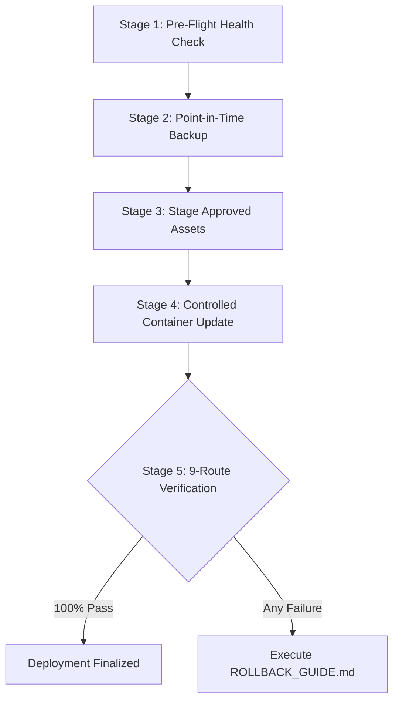

# Lohnour Pro — Production Deployment Runbook

**Target Host:** Sam's Oracle Cloud VM (`141.148.51.166` / `sams-oracle-vm`)  
**Operating System:** Oracle Linux Server 9.7 ARM64 (`aarch64`)  
**Production Directory:** `/opt/lohnour`  
**Governing Standard:** LOHNOUR PRO Fail-Closed Deployment Standard  
**Live Production URL:** `https://pro.lohnour.com`

---

## 1. Production Safety Directives

All deployments to the production VM must strictly honor the following rules:

1. **Zero Cloud Infrastructure Expansion:** Do not provision new VMs, databases, load balancers, or DNS records. Use only the existing Oracle VM.
2. **Preserve Untouched Workloads:** Portainer CE (`portainer`) and Node-RED (`nodered`) run on the same host and must remain running and untouched.
3. **No Database Host Port Exposure:** MariaDB (3306) and WordPress Apache (80) must remain strictly private to Docker internal networks.
4. **Mandatory Pre-Deployment Checkpoint:** Never apply a deployment without first verifying a fresh, cryptographic backup of the database (`lohnour_db_data`) and WordPress filesystem (`lohnour_wp_data`).
5. **No Blind Git Pulls on Production:** Production `/opt/lohnour` is **not** a direct Git repository. Deployments are staged, validated, and applied through controlled, reproducible automation.

---

## 2. Pre-Deployment Prerequisites

From the deployment workstation:

1. Valid SSH key with permissions `0600` pointing to Oracle VM administrative user `opc`:
   ```bash
   chmod 600 ~/.ssh/oracle_key.key
   ```
2. Verify SSH connectivity:
   ```bash
   ssh -i ~/.ssh/oracle_key.key -o ConnectTimeout=5 opc@141.148.51.166 "uptime"
   ```
3. Target branch `developer` is fully tested locally, approved via PR, and merged.

---

## 3. Standard Deployment Procedure

Deployments follow a 5-stage fail-closed lifecycle:



---

### Stage 1: Pre-Flight Health Check

Verify that all existing production containers are running healthy before initiating changes:

```bash
ssh -i ~/.ssh/oracle_key.key opc@141.148.51.166 "sudo docker ps --format 'table {{.Names}}\t{{.Status}}\t{{.Ports}}'"
```

Ensure the following 5 containers are running:
- `lohnour-caddy` (Ports 80, 443)
- `lohnour-wordpress` (healthy)
- `lohnour-db` (healthy)
- `portainer` (healthy/running)
- `nodered` (healthy/running)

---

### Stage 2: Create Pre-Deployment Checkpoint Backup

Run the automated backup script to capture consistent point-in-time snapshots:

```bash
ssh -i ~/.ssh/oracle_key.key opc@141.148.51.166 "sudo bash /opt/lohnour/phase8_backup.sh"
```

Verify the backup checkpoint exists under `/opt/lohnour/backups/`:
- `checkpoint_<timestamp>_db.sql`
- `checkpoint_<timestamp>_wp_data.tar.gz`

---

### Stage 3: Stage Theme / Plugin Updates

When deploying updates to the active Twenty Twenty-Five Child theme or custom CMS plugin:

1. Package the updated theme archive locally:
   ```bash
   tar -czf twentytwentyfive-child.tar.gz -C "current source/lohnourpro_wp_theme" .
   ```

2. Securely copy the archive to the VM staging area:
   ```bash
   scp -i ~/.ssh/oracle_key.key twentytwentyfive-child.tar.gz opc@141.148.51.166:/opt/lohnour/staging/
   ```

3. Extract the update into volume `lohnour_wp_data` and normalize permissions:
   ```bash
   ssh -i ~/.ssh/oracle_key.key opc@141.148.51.166 "
     sudo tar -xzf /opt/lohnour/staging/twentytwentyfive-child.tar.gz -C /var/lib/docker/volumes/lohnour_wp_data/_data/wp-content/themes/twentytwentyfive-child/
     sudo chown -R 33:33 /var/lib/docker/volumes/lohnour_wp_data/_data/wp-content/themes/twentytwentyfive-child/
     sudo find /var/lib/docker/volumes/lohnour_wp_data/_data/wp-content/themes/twentytwentyfive-child/ -type d -exec chmod 755 {} +
     sudo find /var/lib/docker/volumes/lohnour_wp_data/_data/wp-content/themes/twentytwentyfive-child/ -type f -exec chmod 644 {} +
   "
   ```

---

### Stage 4: Controlled Container Update (When Updating Infrastructure)

If updating `docker-compose.yml` or `Caddyfile`:

1. Copy updated manifests to `/opt/lohnour/`:
   ```bash
   scp -i ~/.ssh/oracle_key.key docker-compose.yml Caddyfile opc@141.148.51.166:/opt/lohnour/
   ```

2. Re-apply Compose configuration with zero-downtime container replacement:
   ```bash
   ssh -i ~/.ssh/oracle_key.key opc@141.148.51.166 "cd /opt/lohnour && sudo docker compose up -d"
   ```

3. If only `Caddyfile` was updated, reload Caddy without restarting the container:
   ```bash
   ssh -i ~/.ssh/oracle_key.key opc@141.148.51.166 "sudo docker exec lohnour-caddy caddy reload --config /etc/caddy/Caddyfile"
   ```

---

### Stage 5: Acceptance Testing & 9-Route Verification

Immediately execute the read-only route verification probe from the external client workstation:

```bash
python scripts/test_9_canonical_routes.py
```

All 9 canonical routes must return `HTTP 200 OK` with sub-second response times:
1. `/` (Homepage)
2. `/about/` (About Us)
3. `/services/` (Services Hub)
4. `/coaching/` (Coaching Hub)
5. `/coaching/agentic-ai-foundations/` (Flagship Curriculum)
6. `/guides/` (Knowledge Base)
7. `/contact/` (Contact Page)
8. `/blog/` (Insights & Blog Archive)
9. `/wp-login.php` (Admin Login Portal)

If any route fails, throws PHP fatal warnings, or returns HTTP 500, immediately refer to [ROLLBACK_GUIDE.md](ROLLBACK_GUIDE.md).

