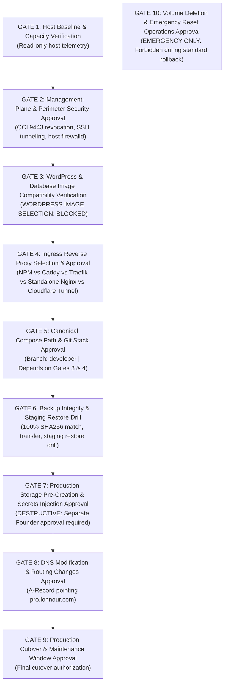
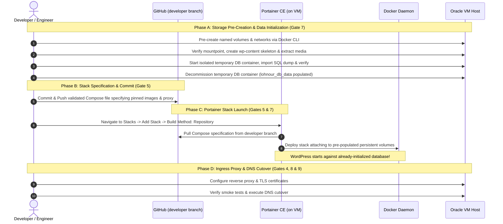

# LOHNOUR PRO — PRODUCTION DEPLOYMENT PLAN & RUNBOOK

**Document Identifier:** `DEPLOYMENT_PLAN.md`  
**Date:** 2026-11-06  
**Auditor / Role:** Lead DevOps Engineer & Infrastructure Security Reviewer  
**Target Environment:** Sam's Oracle VM (Oracle Linux 9.7)  
**Operating Mode:** STRICT READ-ONLY FORENSICS — ZERO MUTATIONS EXECUTED  
**Canonical Documentation Path:** `D:\lohnourpro\docs\DEPLOYMENT_PLAN.md`  
*(Note: Duplicate copies existing in `current source/lohnourpro_wp_theme/my-docs/` are historical theme artifacts and remain untouched).*  
**Status:** **PLAN DEFINED — AWAITING FOUNDER SIGN-OFF & PREREQUISITE DECISIONS**

---

## 1. Operating Protocol & Deployment Mandate

This Deployment Plan defines the exact, sequential execution steps required to deploy the containerized **Lohnour WordPress** platform on **Sam's Oracle VM** using the existing **Portainer** installation.

> [!CAUTION]
> **STRICT OPERATING RULES ENFORCED:**
> 1. No deployment steps are executed during the audit phase.
> 2. Execution of this plan is strictly prohibited without explicit Founder approval.
> 3. Do not modify OCI Security Lists, networking, or host firewalls until Stage 1 sign-off is granted.
> 4. Existing workloads (`Portainer CE` and `Node-RED`) must remain uninterrupted throughout all stages.
> 5. Portainer Web Editor must **NOT** be used; deployment must execute via Portainer's Git Repository integration.
> 6. WordPress must **NEVER** be started against an empty database; database restore and data staging must precede WordPress container launch.
> 7. All persistent named volumes must be explicitly pre-created and directory skeletons verified before any file extraction or database restoration commences.

---

## 2. Pre-Requisites & Verification Gates

Deployment execution is strictly governed by the Canonical 10-Gate Approval Register. No stage may commence until its governing gate criteria are satisfied, prerequisites confirmed, and approvals formally recorded.



### 2.1 Authoritative Gate Dependency Table

| Gate | Title | Prerequisites | Governing Stage | Primary Artifact / Verification Criteria | Approval Authority | Operational Status |
| :---: | :--- | :--- | :---: | :--- | :---: | :---: |
| **GATE 1** | Host Baseline & Capacity Verification | None | Stage 0 | Architecture (`uname -m`), Usable RAM (~22 GiB), Disk capacity | Lead DevOps | `PENDING LIVE VERIFICATION` |
| **GATE 2** | Management-Plane & Perimeter Security Approval | Gate 1 | Stage 1 | OCI Security List port 9443 revocation, SSH tunneling, firewalld | Founder | `PENDING FOUNDER APPROVAL` |
| **GATE 3** | WordPress & Database Image Compatibility Verification | Gate 1 | Stage 2 | Core version, PHP version, plugin compatibility, pinned digests (`image@sha256:...`) | Lead DevOps | `WORDPRESS IMAGE SELECTION: BLOCKED` |
| **GATE 4** | Ingress Reverse Proxy Selection & Approval | Gate 1 | Stage 3 | Architectural selection: NPM vs Caddy vs Traefik vs Standalone Nginx vs Tunnel | Founder | `PROPOSED — NOT APPROVED` |
| **GATE 5** | Canonical Compose Path & Git Stack Approval | **Gates 3 & 4** | Stage 4 | Production `docker-compose.yml` authored with pinned images & proxy, committed to `developer` branch | Founder | `PENDING COMPOSE COMMIT` |
| **GATE 6** | Backup Integrity & Staging Restore Drill | **Gates 3 & 5** | Stage 5 | Local SHA-256 match, host transfer, 9-point dump inspection, isolated staging restore drill | Lead DevOps | `STAGES 2 & 3 PENDING` |
| **GATE 7** | Production Storage Pre-Creation & Secrets Injection | **Gates 5 & 6** | Stage 6 & 7 | Pre-created named volumes, isolated DB init into `lohnour_db_data`, file staging, Portainer deploy | Founder | `GATED — DESTRUCTIVE` |
| **GATE 8** | Domain DNS Cutover Approval | **Gate 7** | Stage 9 | Live host public IP reconfirmed in OCI Console, stack healthy, DNS A-record updated | Founder | `PENDING CUTOVER SCHEDULE` |
| **GATE 9** | Production Cutover Acceptance & Window Close | **Gate 8** | Stage 9 | 9-route acceptance smoke test, TLS verified, maintenance window closed | Founder | `GATED — FINAL GO/NO-GO` |
| **GATE 10** | Volume Deletion & Emergency Reset Operations | Emergency Only | Runbook B/C | Explicit authorization for `docker volume rm`; forbidden during standard ops | Founder | `EMERGENCY ONLY` |

### 2.2 Pre-Requisite Gates Summary

1. **GATE 1: Host Baseline & Capacity Verification (`PENDING LIVE VERIFICATION`):**
   - Host architecture verification (`aarch64` vs `x86_64`), usable memory (22 GiB), and CPU resource budgeting (`1.00 / 1.00 / 0.25 OCPU` labeled `PROPOSED — NOT APPROVED — NOT DEPLOYED`).
2. **GATE 2: Management-Plane & Perimeter Security Approval (`PENDING FOUNDER APPROVAL`):**
   - Revocation of public port 9443 in OCI Security List; transition to SSH tunnel access (`ssh -L 9443:localhost:9443`); host firewalld hardening.
3. **GATE 3: WordPress & Database Image Compatibility Verification (`WORDPRESS IMAGE SELECTION: BLOCKED`):**
   - Database revision `61833` alone is insufficient evidence to select an image. Selection is strictly blocked until the following verification requirements are satisfied:
     - **A. WordPress Core Version:** Identify exact core version from authoritative source/backup; do not infer from database revision alone.
     - **B. PHP Compatibility:** Establish PHP version required by core, `twentytwentyfive-child`, and active plugins; verify required PHP extensions.
     - **C. Plugin Compatibility:** Inspect all installed plugins and versions; verify compatibility with selected core and PHP versions.
     - **D. Database Compatibility:** Establish existing database engine and version; verify compatibility; record limitations of database revision `61833`.
     - **E. Image Reproducibility:** Record exact image tag and immutable digest (`image@sha256:...`); disallow `latest`; verify architecture compatibility (`linux/arm64` vs `linux/amd64`).
4. **GATE 4: Ingress Reverse Proxy Selection & Approval (`PROPOSED — NOT APPROVED`):**
   - Architectural selection between Nginx Proxy Manager, Caddy, Traefik, Standalone Nginx, or Cloudflare Tunnel.
5. **GATE 5: Canonical Compose Path & Git Stack Approval (`PENDING COMPOSE COMMIT`):**
   - *Prerequisite:* Requires Gates 3 and 4 to be finalized.
   - Repository: `https://github.com/tanu268/Lohnour.git`
   - Target Branch: `developer` (`VERIFIED: Branch exists locally and on remote origin`).
   - Compose Location: `COMPOSE FILE LOCATION — NOT YET DECIDED`.
   - *Historical Archive Classification:* `_audit/production-extract/config/docker-compose.yml` is classified as `HISTORICAL ARCHIVE — REFERENCE ONLY — NOT APPROVED FOR PRODUCTION`. A newly authored Compose file specifying the approved images and proxy must be committed to `developer`.
6. **GATE 6: Backup Integrity & Restore Readiness Verification (`STAGE 1 VERIFIED / STAGES 2 & 3 PENDING`):**
   - **Stage 1 (Local Archive Integrity — `VERIFIED`):** Cryptographic hashes in `D:\lohnourpro\_audit\production-extract\manifest-all.sha256` verified 100% locally on 2026-11-06.
   - **Stage 2 (Remote Transfer Integrity — `PENDING TRANSFER & VERIFICATION`):** Authoritative archives transferred to VM staging directory and SHA-256 hashes independently verified on host.
   - **Stage 3 (Restore Validation — `PENDING STAGING VALIDATION`):** 9-point SQL dump inspection, isolated dry-run restore into dedicated staging volume `lohnour_db_staging_data`, and application file verification.
7. **GATE 7: Production Storage Pre-Creation & Secrets Injection Approval (`GATED — DESTRUCTIVE`):**
   - Explicit written authorization required before creating production named volumes, importing production database records, or injecting production secrets.
8. **GATE 8: DNS Modification & Routing Changes Approval (`PENDING CUTOVER SCHEDULE`):**
   - Authority to modify the DNS A-record for `pro.lohnour.com` targeting Sam's Oracle VM previously verified baseline public IP **`141.148.51.166`** (`PREVIOUSLY VERIFIED — Mandatory live confirmation in OCI Console required immediately prior to cutover; current DNS does NOT point to this IP`).
9. **GATE 9: Production Cutover & Maintenance Window Approval (`GATED — FINAL GO/NO-GO`):**
   - Final approval to initiate production traffic cutover during scheduled maintenance window (~3h 05m estimate).
10. **GATE 10: Volume Deletion & Emergency Reset Operations Approval (`EMERGENCY DECOMMISSIONING ONLY`):**
    - Absolute restriction: `docker volume rm` is strictly forbidden during normal operations or rollback; permitted only under explicit Gate 10 decommissioning approval.

### 2.3 Production Execution Roadmap — Six Independent Phase Boundaries (Phases 8–13)

To ensure maximum operational safety and avoid cascaded failures, deployment execution is segmented into six strictly bounded, sequential phases. **Each phase requires its own independent, explicit user authorization before execution. Proceeding from one phase to the next without an explicit user instruction is strictly prohibited.**

| Phase | Phase Title | Governing Scope & Boundaries | Critical Exit Gate Criteria | Post-Phase Action |
| :---: | :--- | :--- | :--- | :---: |
| **Phase 8** | **Production Host Pre-Deployment Backup**<br>*(COMPLETED & VERIFIED)* | - Storage preflight (>= 1.5 GB free)<br>- Mandatory baseline workload presence check (`portainer`, `nodered`, `portainer_data`, `nodered_data`)<br>- Backup existing host configurations (`/etc/caddy`, `/etc/nginx`, firewalld, iptables, ip6tables with strict classification)<br>- Corroborated state-preserving backup of `portainer_data` (clean BoltDB stop/start with multi-tier corroborated exit code verification & post-restart BoltDB datastore health verification)<br>- Race-free state-preserving backup of `nodered_data` (process-frozen snapshot via pause/unpause & immediate recovery tracking)<br>- State-aware cleanup tracking (restores only modified workloads on abort; failure triggers `RECOVERY_REQUIRED`)<br>- Two-part cryptographic integrity verification (`SHA256SUMS` payload checksums excluding manifests, followed by `BACKUP_MANIFEST.sha256`)<br>- **NO Lohnour volume or database modifications.** | **COMPLETED & VERIFIED**: Executed 2026-11-07 04:46:30Z. Backup dir: `/opt/lohnour/backups/phase8_20261107_044630`. All checksums verified 100%; manifest status BACKUP_VERIFIED; Portainer & Node-RED confirmed running (HTTP 200); canonical script SHA-256: `a5b4c44efc7e254a8a04c8f53fb8a0847301ce6fbf1d874531309f476cad9056`. Report: `docs/PHASE_8_PRODUCTION_HOST_BACKUP_REPORT.md`. | **PHASE 8 CLOSED**<br>Await explicit Phase 9 authorization. |
| **Phase 9** | **Infrastructure & Volume Skeleton Preparation**<br>*(COMPLETED & VERIFIED)* | - Create persistent named volumes: `lohnour_wp_data`, `lohnour_db_data`<br>- Create Docker networks: `lohnour_db_network` (internal), `proxy_network`<br>- Resolve volume mountpoints and verify filesystem accessibility.<br>- **NO data import or application container startup.** | **COMPLETED & VERIFIED**: Executed 2026-11-07 05:14:41Z. Volumes `lohnour_wp_data` and `lohnour_db_data` created and verified empty skeletons (`0755 root:root`). Networks `proxy_network` (bridge, 172.18.0.0/16) and `lohnour_db_network` (internal bridge, 172.19.0.0/16) created with 0 containers attached. Workloads Portainer and Node-RED verified healthy (HTTP 200). Report: `docs/PHASE_9_PRODUCTION_INFRASTRUCTURE_REPORT.md`. | **PHASE 9 CLOSED**<br>Await explicit Phase 10 authorization. |
| **Phase 10** | **Production Database Recovery & Table Validation** | - Spin up temporary isolated MariaDB container on internal network.<br>- Inject credentials via secured temporary option file (0600 in 0700 dir).<br>- Restore `production-lohnour_wp.sql` into `lohnour_db_data`.<br>- Validate table schema, record count (`wp_posts`), and options.<br>- Clean up option file via exit traps; terminate init container.<br>- **NO WordPress container startup.** | Table count matches source (14 tables: 12 WordPress core + 2 Sendinblue/Brevo plugin tables); `wp_posts` count verified; zero secret exposure. | **MANDATORY STOP**<br>Await explicit Phase 11 authorization. |
| **Phase 11** | **WordPress Application File & Uploads Restoration** | - Extract `uploads.tar.gz` into `lohnour_wp_data/wp-content/uploads`.<br>- Extract `lohnour_all_plugins.tar.gz` and child theme into plugins/themes.<br>- Enforce strict permission boundaries (`www-data:www-data` 750/640 for uploads; `root:root` 755/644 for code).<br>- Verify directory tree and file ownership.<br>- **Stack remains undeployed.** | Target directory structure intact; write protection on PHP code verified. | **MANDATORY STOP**<br>Await explicit Phase 12 authorization. |
| **Phase 12** | **Portainer Stack Deployment & Internal Application Acceptance** | - Deploy canonical stack via Portainer Git Repository integration (`developer` branch).<br>- Inject runtime secrets via Portainer UI.<br>- Attach to pre-populated volumes and networks.<br>- Execute internal container health checks and 9-route bootstrap test.<br>- **NO DNS or public ingress modification.** | All containers report `healthy`; internal HTTP/CLI smoke tests return HTTP 200. | **MANDATORY STOP**<br>Await explicit Phase 13 authorization. |
| **Phase 13** | **Ingress Reverse Proxy & Production DNS Cutover** | - Deploy/configure reverse proxy (Caddy) on `proxy_network`.<br>- Bind host ports 80/443; obtain Let's Encrypt TLS certificates.<br>- Validate staging ingress via local hosts resolution / curl.<br>- Point DNS A-record for `pro.lohnour.com` to VM public IP (`141.148.51.166`).<br>- Execute public 9-route end-to-end acceptance suite.<br>- Close maintenance window. | Public SSL valid; all 9 canonical routes return HTTP 200; zero regression on existing workloads. | **DEPLOYMENT COMPLETE**<br>Handover to operations. |

---

## 3. GitHub + Existing Portainer Deployment Workflow



### 3.1 Multi-Phase Deployment Architecture & Volume Lifecycle
Standard Portainer Git deployments launch all stack services concurrently. If WordPress starts before MariaDB has restored the database, it attempts initial setup on an empty database, auto-creating conflicting tables. Furthermore, Docker named volumes created on-the-fly do not contain application subdirectories (`wp-content/themes`, `plugins`, `uploads`).

To resolve this, the deployment enforces a **strict multi-phase sequence**:
1. **Phase A (Storage Pre-Creation & Data Staging — Gate 7):** The named persistent volumes (`lohnour_wp_data`, `lohnour_db_data`) and bridge networks are explicitly pre-created before stack deployment. Application archives are extracted into the volume mountpoint with verified directory structures, and the production database is initialized using a temporary isolated MariaDB container.
2. **Phase B (Stack Specification & External Resource Binding — Gate 5):** The production Compose file MUST explicitly reuse these pre-created resources by declaring them with `external: true` and their exact names:
   ```yaml
   volumes:
     lohnour_wp_data:
       external: true
       name: lohnour_wp_data
     lohnour_db_data:
       external: true
       name: lohnour_db_data

   networks:
     lohnour_db_network:
       external: true
       name: lohnour_db_network
     proxy_network:
       external: true
       name: proxy_network
   ```
   *Crucial Constraint:* Resource reuse must **NOT** be claimed until the canonical Compose configuration is authored, committed, and independently verified to contain these exact `external: true` directives. If omitted, Compose will create new project-prefixed volumes (e.g. `lohnour_lohnour_wp_data`), leaving WordPress on an empty volume.
3. **Phase C (Stack Deployment via Portainer Git Repository — Gates 5 & 7):** Portainer pulls the approved Compose file from the `developer` branch. Because volumes are declared external, WordPress attaches directly to the pre-populated volumes and launches against an already-initialized database.
4. **Phase D (Ingress & DNS Cutover — Gates 4, 8 & 9):** The reverse proxy routes traffic to WordPress, TLS is terminated, and public DNS is cut over.

### 3.2 Portainer Git Authentication & Path Resolution
- **Repository URL:** `https://github.com/tanu268/Lohnour.git`
- **Target Branch:** `refs/heads/developer`
- **Authentication Standard:**
  - If public: No authentication required.
  - If private: Portainer Git integration must use a GitHub Personal Access Token (PAT) with `repo:read` scope. Authentication is configured securely via Portainer's UI **Authentication** toggle (Username + PAT). Credentials are encrypted within `portainer_data` and **NEVER** committed to Git.
- **Compose Specification Path:** Pinned path to canonical Compose file (`COMPOSE FILE LOCATION — NOT YET DECIDED` until committed under Gate 5).
- **PHP Configuration Bind Mount (`uploads.ini`):**
  - *Relative Path Resolution Caveat:* Do NOT assume a fixed internal Portainer clone path (e.g. `/data/compose/...`). Portainer's working directory and relative path resolution behavior for bind mounts vary by Portainer version and host deployment mode.
  - *Verification Requirement:* The actual resolution of relative bind mount `./config/uploads.ini:/usr/local/etc/php/conf.d/uploads.ini:ro` must be empirically tested during Stage 4 Compose verification. If relative bind mount resolution fails or behaves inconsistently, an explicit verified host configuration path (e.g., `/opt/lohnour/config/uploads.ini`) must be used as the documented fallback. Resource integration must not be claimed without recorded test evidence.

---

## 4. Sequential Deployment Runbook

---

### Stage 0: Host OS & Infrastructure Baseline Verification
**Classification:** Read-only | **Governing Gate:** **GATE 1**  
**Estimated Time:** 15 minutes | **Target:** Sam's Oracle VM Terminal via SSH  

1. **Verify CPU Architecture:**
   ```bash
   uname -m
   ```
   *Action:* If `aarch64`, confirm all images pulled support ARM64 multi-arch manifests. If `x86_64`, standard AMD64 applies.
2. **Inspect Host Firewall Daemon:**
   ```bash
   sudo systemctl status firewalld
   ```
   *Action:* If active, verify allowed services:
   ```bash
   sudo firewall-cmd --list-all
   ```
   Ensure `http` and `https` services are permitted; ensure ports `9443` and `1880` are not publicly exposed.
3. **Inspect SELinux Mode:**
   ```bash
   getenforce
   ```
   *Action:* If `Enforcing`, confirm container SELinux policy allows volume mounts or append `:z` flags ONLY to specific application host-bind mounts. Never apply `:z` to host system directories or Docker named volumes.
4. **Inspect Existing Workloads:**
   ```bash
   docker ps --format "table {{.ID}}\t{{.Names}}\t{{.Image}}\t{{.Status}}\t{{.Ports}}"
   docker volume ls
   ```
   *Action:* Confirm existing `portainer` and `nodered` containers and volumes (`portainer_data`, `nodered_data`) are running normally and remain untouched.

---

### Stage 1: Management-Plane & Perimeter Security Hardening
**Classification:** Reversible Configuration | **Governing Gate:** **GATE 2**  
**Estimated Time:** 15 minutes | **Target:** SSH Client & OCI Console  

> [!CRITICAL]
> **LOCKOUT PREVENTION & VERIFICATION SEQUENCE (BLOCKER 8 RESOLUTION):**  
> To prevent an accidental administrative lockout, direct access to Portainer must NEVER be restricted before secure SSH tunnel access is confirmed operational. The following sequential order is mandatory:  
> 1. Confirm SSH administrative connectivity to Sam's Oracle VM.  
> 2. Establish and test the intended local SSH tunnel.  
> 3. Verify that Portainer is reachable and manageable through `https://localhost:9443`.  
> 4. Verify that the operator retains an administrative recovery path.  
> 5. Only then consider restricting or revoking public OCI ingress rules for port 9443, subject to explicit Founder approval under **Gate 2**.

1. **Confirm Administrative SSH Access:**
   ```bash
   ssh -i ~/.ssh/oracle_key.key -o BatchMode=yes opc@141.148.51.166 "echo 'SSH connectivity verified'"
   ```
   *(Note: Target IP `141.148.51.166` is the previously verified baseline public IP; live reconfirmation in OCI Console is required prior to cutover. Current DNS does NOT point to this IP).*
2. **Establish & Test Local SSH Port Forwarding Tunnel:**
   ```bash
   ssh -i ~/.ssh/oracle_key.key -N -L 9443:localhost:9443 opc@141.148.51.166
   ```
3. **Verify Portainer Access via Secure Tunnel:**
   - Open browser on local administrative workstation: `https://localhost:9443`.
   - Authenticate to Portainer CE and verify container dashboard renders correctly.
4. **OCI Security List Rule Revocation (`GATE 2 — FOUNDER APPROVAL REQUIRED`):**
   - *Prerequisite Check:* Proceed ONLY after Steps 1–3 above confirm working tunnel access.
   - In OCI Console -> Virtual Cloud Networks -> VCN -> Security Lists:
   - Edit Ingress Rule for Port `9443`: Delete rule permitting `0.0.0.0/0` or restrict to `<Founder_Static_IP>/32`.
   - *Status:* `HOLD — PENDING GATE 2 APPROVAL AND WORKING TUNNEL VERIFICATION`.

---

### Stage 2: Container Image Compatibility Verification & Digest Pinning
**Classification:** Read-only Verification | **Governing Gate:** **GATE 3**  
**Estimated Time:** 20 minutes | **Status:** **`WORDPRESS IMAGE SELECTION: BLOCKED`**  

*Execution cannot proceed past this stage until all compatibility criteria are verified and digests recorded:*

1. **WordPress Core Version:** Identify exact WordPress core version from authoritative source/backup; do not infer from database revision alone.
2. **PHP Compatibility:** Establish PHP version required by core, `twentytwentyfive-child`, and active plugins; verify required PHP extensions.
3. **Plugin Compatibility:** Inspect all installed plugins and versions; verify compatibility with selected core and PHP versions.
4. **MariaDB Compatibility:** Establish existing database engine and version; verify compatibility with schema revision `61833`.
5. **CPU Platform Compatibility:** Confirm image platform support matches host architecture (`linux/arm64` vs `linux/amd64`).
6. **Immutable Digest Pinning:** Select immutable image tags and record SHA-256 digests (`image@sha256:...`); disallow rolling `:latest` tags.
7. *Gate 3 Exit Criterion:* Explicit technical record documenting pinned WordPress and MariaDB image digests.

---

### Stage 3: Ingress Reverse Proxy Architecture Selection & Approval
**Classification:** Architectural Decision | **Governing Gate:** **GATE 4**  
**Estimated Time:** 15 minutes | **Status:** **HOLD — GATED BY FOUNDER ARCHITECTURAL DECISION**  

1. **Evaluate Reverse Proxy Options:** Review trade-offs between Nginx Proxy Manager, Caddy, Traefik, Standalone Nginx, and Cloudflare Tunnel.
2. **Founder Selection Sign-Off:** Founder formally approves the selected proxy architecture.
3. *Gate 4 Exit Criterion:* Approved ingress proxy architecture documented with container image, port mappings, and routing strategy.

---

### Stage 4: Canonical Compose Path & Git Repository Finalization
**Classification:** Read-only Verification & Commit | **Governing Gate:** **GATE 5**  
**Estimated Time:** 15 minutes | **Target:** Local Workspace & GitHub  
**Prerequisites:** **GATE 3 & GATE 4 COMPLETE**  

1. **Verify Target Branch:** Confirm branch `developer` exists locally and on remote `origin` (`git branch -a`).
2. **Author Canonical Compose File:** Incorporate pinned images from Gate 3, selected proxy from Gate 4, and resource limits (`1.00 / 1.00 / 0.25 OCPU`).
3. **Commit Compose to Git:** Commit production `docker-compose.yml` to the `developer` branch.
4. *Gate 5 Exit Criterion:* Canonical Compose path agreed and verified on GitHub `developer` branch.

---

### Stage 5: Artifact Staging, Verifiable Governance & Staging Restore Drill
**Classification:** Mutating Staging Operation & Validation | **Governing Gate:** **GATE 6**  
**Estimated Time:** 25 minutes | **Target:** Local Admin Workstation -> Sam's Oracle VM  

#### 1. Verifiable Operator Approval Checkpoint (INDEPENDENT PROVENANCE VERIFICATION):
Modifying directory attributes or creating host paths constitutes an intentional mutation. Manually entered approver names or self-attestation in command-line prompts are strictly prohibited as proof of authorization. Execution requires an independently provisioned approval record file created out-of-band by the Founder with restricted root permissions.

```bash
TARGET_DIR="/opt/lohnour/staging"
EXPECTED_USER="opc"
EXPECTED_GROUP="opc"
EXPECTED_MODE="700"
CR_ID="CR-LOHNOUR-STAGE5"
APPROVAL_DIR="/etc/lohnour/approvals"
APPROVAL_FILE="${APPROVAL_DIR}/${CR_ID}.approved"
AUDIT_LOG="/var/log/lohnour_governance.log"
OPERATOR_USER=$(whoami)
EXEC_TIMESTAMP=$(date -u +"%Y-%m-%dT%H:%M:%SZ")

echo "========================================================================"
echo "GATE 6 APPROVAL CHECKPOINT: Independent Approval Verification"
echo "Target Path: ${TARGET_DIR} | Required Attributes: ${EXPECTED_USER}:${EXPECTED_GROUP} ${EXPECTED_MODE}"
echo "Checking Independent Approval Record: ${APPROVAL_FILE}"
echo "========================================================================"

# 1. Verify existence of independently provisioned approval file
if [ ! -f "${APPROVAL_FILE}" ]; then
  echo "FATAL: Independent approval record ${APPROVAL_FILE} does not exist." >&2
  echo "Host mutation BLOCKED. Founder sign-off artifact must be provisioned before execution." >&2
  logger -t lohnour-deploy "[GATE 6] BLOCKED: Missing approval file ${APPROVAL_FILE} for operator ${OPERATOR_USER}" 2>/dev/null || true
  exit 1
fi

# 2. Verify approval file permissions are root-restricted (mode 0400/0600 owned by root)
APPROVAL_PERMS=$(stat -c "%a" "${APPROVAL_FILE}" 2>/dev/null || echo "000")
APPROVAL_OWNER=$(stat -c "%U" "${APPROVAL_FILE}" 2>/dev/null || echo "unknown")
if [ "${APPROVAL_OWNER}" != "root" ] || { [ "${APPROVAL_PERMS}" != "400" ] && [ "${APPROVAL_PERMS}" != "600" ]; }; then
  echo "FATAL: Insecure ownership/permissions on ${APPROVAL_FILE} (${APPROVAL_OWNER}:${APPROVAL_PERMS}). Must be root:root mode 0400. Aborting." >&2
  exit 1
fi

# 3. Parse and validate approval metadata
# shellcheck source=/dev/null
source "${APPROVAL_FILE}"

if [ "${APPROVED_TARGET_STAGE:-}" != "STAGE5_STAGING" ] || [ "${APPROVED_TARGET_PATH:-}" != "${TARGET_DIR}" ]; then
  echo "FATAL: Approval record metadata mismatch (Stage=${APPROVED_TARGET_STAGE:-unset}, Path=${APPROVED_TARGET_PATH:-unset}). Aborting." >&2
  exit 1
fi

APPROVER_NAME="${APPROVED_BY:-Founder}"
echo "Independent Approval Verified: CR=${CR_ID} | Approver=${APPROVER_NAME} | Target=${TARGET_DIR} | Operator=${OPERATOR_USER}"

# Pre-Transfer Storage Verification (> 500 MiB free space required)
AVAIL_KB=$(df -k /opt | tail -n 1 | awk '{print $4}')
if [ "${AVAIL_KB}" -lt 524288 ]; then
  echo "FATAL: Insufficient disk space on /opt (${AVAIL_KB} KB available, required 524288 KB). Aborting." >&2
  exit 1
fi

# Directory Attribute Inspection & Safe Non-Recursive Reconciliation
if [ -d "${TARGET_DIR}" ]; then
  CURRENT_OWNER=$(stat -c "%U" "${TARGET_DIR}" 2>/dev/null || echo "unknown")
  CURRENT_GROUP=$(stat -c "%G" "${TARGET_DIR}" 2>/dev/null || echo "unknown")
  CURRENT_MODE=$(stat -c "%a" "${TARGET_DIR}" 2>/dev/null || echo "000")
  if [ "${CURRENT_OWNER}" != "${EXPECTED_USER}" ] || [ "${CURRENT_GROUP}" != "${EXPECTED_GROUP}" ]; then
    sudo chown "${EXPECTED_USER}:${EXPECTED_GROUP}" "${TARGET_DIR}"
  fi
  if [ "${CURRENT_MODE}" != "${EXPECTED_MODE}" ]; then
    chmod "${EXPECTED_MODE}" "${TARGET_DIR}"
  fi
else
  sudo mkdir -p "${TARGET_DIR}"
  sudo chown "${EXPECTED_USER}:${EXPECTED_GROUP}" "${TARGET_DIR}"
  chmod "${EXPECTED_MODE}" "${TARGET_DIR}"
fi

FINAL_MODE=$(stat -c "%a" "${TARGET_DIR}" 2>/dev/null || echo "000")
RECORDED_RESULT="SUCCESS: ${TARGET_DIR} verified as ${EXPECTED_USER}:${EXPECTED_GROUP} mode ${FINAL_MODE}"
echo "[${EXEC_TIMESTAMP}] CR=${CR_ID} | Approver=${APPROVER_NAME} | Operator=${OPERATOR_USER} | Path=${TARGET_DIR} | Result=${RECORDED_RESULT}" | sudo tee -a "${AUDIT_LOG}" >/dev/null
logger -t lohnour-deploy "[GATE 6] CR=${CR_ID} approved by ${APPROVER_NAME} executed by ${OPERATOR_USER}: ${RECORDED_RESULT}" 2>/dev/null || true
```

#### 2. Transfer Authoritative Archives via SCP:
```powershell
# Executed from local administrative workstation targeting previously verified baseline IP (141.148.51.166)
scp -i ~/.ssh/oracle_key.key D:\lohnourpro\_audit\production-extract\database\production-lohnour_wp.sql opc@141.148.51.166:/opt/lohnour/staging/
scp -i ~/.ssh/oracle_key.key D:\lohnourpro\_audit\production-extract\uploads.tar.gz opc@141.148.51.166:/opt/lohnour/staging/
scp -i ~/.ssh/oracle_key.key D:\lohnourpro\_audit\production-extract\twentytwentyfive-child.tar.gz opc@141.148.51.166:/opt/lohnour/staging/
scp -i ~/.ssh/oracle_key.key D:\lohnourpro\_audit\production-extract\lohnour_all_plugins.tar.gz opc@141.148.51.166:/opt/lohnour/staging/
scp -i ~/.ssh/oracle_key.key D:\lohnourpro\_audit\production-extract\config\uploads.ini opc@141.148.51.166:/opt/lohnour/staging/
scp -i ~/.ssh/oracle_key.key D:\lohnourpro\_audit\production-extract\manifest-all.sha256 opc@141.148.51.166:/opt/lohnour/staging/
```

#### 3. Remote Cryptographic Hash Verification on Host (Gate 6 — Stage 2):
```bash
cd /opt/lohnour/staging
sha256sum -c manifest-all.sha256
```
Do not proceed if any checksum mismatch occurs.

#### 4. Pre-Restore SQL Dump Forensic Inspection Protocol:
Before executing staging import, inspect `production-lohnour_wp.sql` across 9 verification criteria:
1. `CREATE DATABASE`: Verify no unapproved schema creation or system schema overwrite.
2. `USE`: Verify no hardcoded `USE` overrides target database `lohnour_wp`.
3. `DEFINER`: Check for definers (`root@localhost`) on views/triggers.
4. Schema references: Verify all SQL statements operate strictly within target schema.
5. Table prefixes: Verify table naming structure (`wp_`).
6. SQL syntax: Check MariaDB version compatibility.
7. Required privileges: Confirm unprivileged user `lohnour_user` can import cleanly.
8. Unexpected objects: Inspect for custom routines, triggers, or scheduled events.
9. Dump completeness: Confirm dump termination marker (`/* Dump completed on ... */`) and SHA-256 match.

#### 5. Staging Database Restore Validation Drill (Gate 6 — Stage 3):
Execute isolated dry-run database restore drill using dedicated staging volume `lohnour_db_staging_data`:
```bash
# Explicitly pre-create dedicated staging volume
docker volume create lohnour_db_staging_data

# Start isolated staging test container with health check
docker run -d \
  --name lohnour-db-staging \
  -v lohnour_db_staging_data:/var/lib/mysql \
  -e MYSQL_ROOT_PASSWORD="<STAGING_ROOT_PASSWORD>" \
  -e MYSQL_DATABASE=lohnour_wp \
  -e MYSQL_USER=lohnour_user \
  -e MYSQL_PASSWORD="<STAGING_USER_PASSWORD>" \
  --health-cmd='mariadb-admin ping -h 127.0.0.1 -u lohnour_user --password="$MYSQL_PASSWORD" --silent || exit 1' \
  --health-interval=5s \
  --health-timeout=3s \
  --health-retries=10 \
  --health-start-period=15s \
  <pinned_mariadb_digest>

# Bounded readiness probe (maximum 60 seconds)
MAX_RETRIES=12; COUNT=0; HEALTH_STATUS="starting"
until [ "$COUNT" -ge "$MAX_RETRIES" ]; do
  HEALTH_STATUS=$(docker inspect -f '{{if .State.Health}}{{.State.Health.Status}}{{else}}unknown{{end}}' lohnour-db-staging 2>/dev/null || echo "not_found")
  if [ "${HEALTH_STATUS}" = "healthy" ]; then break; fi
  sleep 5; COUNT=$((COUNT + 1))
done

if [ "${HEALTH_STATUS}" != "healthy" ]; then
  echo "FATAL: Staging database failed health probe." >&2; exit 1
fi

# Import dump using secured option file (Phase 7.3 verified parameter expansion)
CLIENT_CNF_DIR=$(mktemp -d /opt/lohnour/staging/db_cnf.XXXXXX)
chmod 700 "${CLIENT_CNF_DIR}"
CLIENT_CNF="${CLIENT_CNF_DIR}/client.cnf"

trap 'docker exec lohnour-db-staging rm -f /tmp/client.cnf 2>/dev/null || true; rm -rf "${CLIENT_CNF_DIR}" 2>/dev/null || true' EXIT INT TERM

# Pure parameter expansion escaping (handles \, ", $, ;, #, spaces safely without process leaks)
ESCAPED_DB_PASS="${STAGING_USER_PASSWORD//\\/\\\\}"
ESCAPED_DB_PASS="${ESCAPED_DB_PASS//\"/\\\"}"

printf '[client]\nuser=lohnour_user\nhost=127.0.0.1\npassword="%s"\n' "${ESCAPED_DB_PASS}" > "${CLIENT_CNF}"
chmod 600 "${CLIENT_CNF}"

docker cp "${CLIENT_CNF}" lohnour-db-staging:/tmp/client.cnf
docker exec lohnour-db-staging chmod 600 /tmp/client.cnf

docker exec -i lohnour-db-staging mariadb --defaults-extra-file=/tmp/client.cnf lohnour_wp < /opt/lohnour/staging/production-lohnour_wp.sql

# Verify tables and record counts
docker exec -i lohnour-db-staging mariadb --defaults-extra-file=/tmp/client.cnf -e "SHOW TABLES; SELECT count(*) FROM wp_posts;" lohnour_wp

# Decommission temporary container; retain staging volume as retained staging reference
docker exec lohnour-db-staging rm -f /tmp/client.cnf
rm -rf "${CLIENT_CNF_DIR}"
trap - EXIT INT TERM
docker stop lohnour-db-staging && docker rm lohnour-db-staging
```
*Staging Volume Policy:* `lohnour_db_staging_data` is retained as a **`retained staging reference`** under Gate 10 deletion governance. Routine deletion via `docker volume rm` is strictly prohibited.

---

### Stage 6: Production Storage Pre-Creation & Phased Volume Initialization
**Classification:** Destructive Operation (Mutating Database & Volumes) | **Governing Gate:** **GATE 7**  
**Estimated Time:** 25 minutes | **Target:** Host Terminal  
**Prerequisites:** **GATES 5 & 6 COMPLETE — EXPLICIT FOUNDER APPROVAL REQUIRED**  

#### Step 6.1: Explicit Production Volume & Network Pre-Creation (BLOCKER 1 RESOLUTION)
To guarantee that volumes exist before extraction or database restore, and to prevent Portainer from launching WordPress against an empty database:
```bash
docker volume create lohnour_wp_data
docker volume create lohnour_db_data
docker network create lohnour_db_network --internal
docker network create proxy_network
```

#### Step 6.2: Mountpoint Resolution, Skeleton Creation & Application File Staging
```bash
WP_DATA_DIR=$(docker volume inspect lohnour_wp_data --format '{{ .Mountpoint }}' 2>/dev/null || echo "")

if [ -z "${WP_DATA_DIR}" ] || [ ! -d "${WP_DATA_DIR}" ]; then
  echo "FATAL: lohnour_wp_data volume mountpoint unresolved or inaccessible. Aborting extraction." >&2
  exit 1
fi

echo "Resolved WordPress Volume Mountpoint: ${WP_DATA_DIR}"

# Explicitly create required directory skeleton before extraction
sudo mkdir -p "${WP_DATA_DIR}/wp-content/themes" \
              "${WP_DATA_DIR}/wp-content/plugins" \
              "${WP_DATA_DIR}/wp-content/uploads"

# Extract authoritative archives into verified subdirectories
sudo tar -xzf /opt/lohnour/staging/uploads.tar.gz -C "${WP_DATA_DIR}/wp-content/"
sudo tar -xzf /opt/lohnour/staging/twentytwentyfive-child.tar.gz -C "${WP_DATA_DIR}/wp-content/themes/"
sudo tar -xzf /opt/lohnour/staging/lohnour_all_plugins.tar.gz -C "${WP_DATA_DIR}/wp-content/plugins/"

# Filesystem Ownership & Permission Normalization (Narrowly Scoped Security Protocol)
# 1. Do NOT assume UID/GID 33:33 without verification. Inspect the actual container image:
WP_UID=$(docker run --rm <pinned_wordpress_digest> id -u)
WP_GID=$(docker run --rm <pinned_wordpress_digest> id -g)
echo "Verified WordPress runtime image identity: UID=${WP_UID}, GID=${WP_GID}"

# 2. Restrict write permissions STRICTLY to the staged uploads directory where media is stored:
sudo chown -R "${WP_UID}:${WP_GID}" "${WP_DATA_DIR}/wp-content/uploads"
sudo find "${WP_DATA_DIR}/wp-content/uploads" -type d -exec chmod 750 {} +
sudo find "${WP_DATA_DIR}/wp-content/uploads" -type f -exec chmod 640 {} +

# 3. Executable code directories (themes, plugins) remain read-only to web runtime (root-owned)
# to prevent web-borne PHP code modification:
sudo chown -R root:root "${WP_DATA_DIR}/wp-content/themes" "${WP_DATA_DIR}/wp-content/plugins"
sudo find "${WP_DATA_DIR}/wp-content/themes" "${WP_DATA_DIR}/wp-content/plugins" -type d -exec chmod 755 {} +
sudo find "${WP_DATA_DIR}/wp-content/themes" "${WP_DATA_DIR}/wp-content/plugins" -type f -exec chmod 644 {} +
```

#### Step 6.3: Isolated Production Database Initialization (Under Gate 7)
Before starting the full application stack in Portainer, populate `lohnour_db_data` using a temporary isolated MariaDB container:
```bash
docker run -d --name lohnour-db-init \
  --network lohnour_db_network \
  -v lohnour_db_data:/var/lib/mysql \
  -e MYSQL_ROOT_PASSWORD="${DB_ROOT_PASSWORD}" \
  -e MYSQL_DATABASE=lohnour_wp \
  -e MYSQL_USER=lohnour_user \
  -e MYSQL_PASSWORD="${DB_PASSWORD}" \
  --health-cmd='mariadb-admin ping -h 127.0.0.1 -u lohnour_user --password="$MYSQL_PASSWORD" --silent || exit 1' \
  --health-interval=5s \
  --health-timeout=3s \
  --health-retries=10 \
  --health-start-period=15s \
  <pinned_mariadb_digest>

# Bounded readiness probe loop
MAX_RETRIES=12; COUNT=0; HEALTH_STATUS="starting"
until [ "$COUNT" -ge "$MAX_RETRIES" ]; do
  HEALTH_STATUS=$(docker inspect -f '{{if .State.Health}}{{.State.Health.Status}}{{else}}unknown{{end}}' lohnour-db-init 2>/dev/null || echo "not_found")
  if [ "${HEALTH_STATUS}" = "healthy" ]; then break; fi
  sleep 5; COUNT=$((COUNT + 1))
done

if [ "${HEALTH_STATUS}" != "healthy" ]; then
  echo "FATAL: Production database container failed to reach healthy state." >&2
  docker logs --tail 50 lohnour-db-init
  exit 1
fi

# Import production dump using failure-safe client option file (Phase 7.3 verified parameter expansion)
CLIENT_CNF_DIR=$(mktemp -d /opt/lohnour/staging/db_cnf.XXXXXX)
chmod 700 "${CLIENT_CNF_DIR}"
CLIENT_CNF="${CLIENT_CNF_DIR}/client.cnf"

trap 'docker exec lohnour-db-init rm -f /tmp/client.cnf 2>/dev/null || true; rm -rf "${CLIENT_CNF_DIR}" 2>/dev/null || true' EXIT INT TERM

# Pure parameter expansion escaping (handles \, ", $, ;, #, spaces safely without process leaks)
ESCAPED_DB_PASS="${DB_PASSWORD//\\/\\\\}"
ESCAPED_DB_PASS="${ESCAPED_DB_PASS//\"/\\\"}"

printf '[client]\nuser=lohnour_user\nhost=127.0.0.1\npassword="%s"\n' "${ESCAPED_DB_PASS}" > "${CLIENT_CNF}"
chmod 600 "${CLIENT_CNF}"

docker cp "${CLIENT_CNF}" lohnour-db-init:/tmp/client.cnf
docker exec lohnour-db-init chmod 600 /tmp/client.cnf

docker exec -i lohnour-db-init mariadb --defaults-extra-file=/tmp/client.cnf lohnour_wp < /opt/lohnour/staging/production-lohnour_wp.sql

# Verify table count and critical records
docker exec -i lohnour-db-init mariadb --defaults-extra-file=/tmp/client.cnf -e "SHOW TABLES; SELECT count(*) FROM wp_posts; SELECT option_name, option_value FROM wp_options WHERE option_name IN ('siteurl', 'home');" lohnour_wp

# Cleanup option file and decommission temporary init container
docker exec lohnour-db-init rm -f /tmp/client.cnf
rm -rf "${CLIENT_CNF_DIR}"
trap - EXIT INT TERM

docker stop lohnour-db-init && docker rm lohnour-db-init
echo "Production database volume lohnour_db_data successfully initialized."
```

---

### Stage 7: Production Stack Deployment via Portainer Git Repository
**Classification:** Reversible Deployment | **Governing Gates:** **GATE 5 & GATE 7**  
**Estimated Time:** 15 minutes | **Target:** Portainer UI (`https://localhost:9443` via SSH Tunnel)  

1. **Deploy Production Stack via Portainer UI:**
   - Connect via local SSH tunnel (`ssh -L 9443:localhost:9443 opc@141.148.51.166`).
   - Open browser: `https://localhost:9443`.
   - Navigate to **Stacks -> Add Stack** (Build method: **Repository**).
   - **Repository URL:** `https://github.com/tanu268/Lohnour.git`
   - **Repository reference:** `refs/heads/developer`
   - **Authentication:** Enable and provide GitHub Username and Personal Access Token (if private).
   - **Compose path:** Pinned path to canonical Compose file.
   - **Environment Variables:** Provide `DB_ROOT_PASSWORD` and `DB_PASSWORD` securely via Portainer's UI panel.
   - Click **Deploy the stack**.
   - *Result:* Portainer attaches the stack to the pre-created, pre-populated named volumes (`lohnour_wp_data`, `lohnour_db_data`) and networks. WordPress starts against an already-initialized database!

2. **Verify Container Health & Logs:**
   ```bash
   docker ps --filter "name=lohnour-" --format "table {{.Names}}\t{{.Status}}\t{{.Ports}}"
   docker logs --tail 50 lohnour-wordpress
   ```

3. **Verify PHP Injected Runtime Limits:**
   ```bash
   docker exec lohnour-wordpress php -i | grep -E 'upload_max_filesize|post_max_size|memory_limit'
   ```

4. **Internal Application Smoke Test (Image-Specific):**
   - *Method A (For Apache-based WordPress Images):* In-container HTTP stream probe on port 80:
     ```bash
     docker exec lohnour-wordpress php -r '
     $ctx = stream_context_create(["http" => ["timeout" => 10, "ignore_errors" => true]]);
     $fp = @fopen("http://127.0.0.1:80/", "r", false, $ctx);
     if ($fp) { echo "HTTP Probe Success: " . stream_get_meta_data($fp)["wrapper_data"][0] . "\n"; fclose($fp); }
     else { fwrite(STDERR, "FATAL: Smoke test failed on port 80.\n"); exit(1); }
     '
     ```
   - *Method B (For PHP-FPM WordPress Images — Application Execution & DB Bootstrap Probe):*
     # Note: Simple TCP socket tests (e.g. fsockopen on port 9000) only prove the FastCGI daemon is listening;
     # they do NOT test PHP execution, WordPress loading, or database connectivity.
     # The following bootstrap test validates actual WordPress core execution, database connectivity, and option retrieval:
     ```bash
     docker exec lohnour-wordpress php -r '
     define("WP_USE_THEMES", false);
     require_once "/var/www/html/wp-load.php";
     global $wpdb;
     if ($wpdb->check_connection() && get_option("siteurl")) {
         echo "PHP-FPM Application Health Success: WordPress core loaded and database connected successfully.\n";
         exit(0);
     } else {
         fwrite(STDERR, "FATAL: WordPress bootstrap failed or database query failed.\n");
         exit(1);
     }
     '
     ```
   - *Method C (End-to-End Ingress Smoke Test via Reverse Proxy on proxy_network):*
     ```bash
     docker run --rm --network proxy_network curlimages/curl:8.5.0 -s -o /dev/null -w "%{http_code}\n" --max-time 10 "http://lohnour-wordpress:80/"
     ```

---

### Stage 8: Ingress Reverse Proxy Configuration & TLS Setup
**Classification:** Reversible Configuration | **Governing Gate:** **GATE 4**  
**Estimated Time:** 20 minutes | **Status:** **HOLD — GATED BY GATE 4 REVERSE PROXY SELECTION**  

1. Deploy approved reverse proxy container connected to `proxy_network`.
2. Configure upstream proxy pass to `lohnour-wordpress:80` (or FastCGI proxy pass to `lohnour-wordpress:9000`).
3. Bind host ports 80 and 443.
4. Issue and bind TLS certificates (Let's Encrypt / ZeroSSL).
5. Enforce security headers: HSTS, `X-Content-Type-Options: nosniff`, `X-Frame-Options: SAMEORIGIN` (omit obsolete `X-XSS-Protection`).
6. Verify local port listeners: `sudo ss -tulpn | grep -E ':(80|443)'`.

---

### Stage 9: Public DNS Cutover & Production Acceptance
**Classification:** Reversible Routing / Acceptance | **Governing Gates:** **GATE 8 & GATE 9**  
**Estimated Time:** 25 minutes | **Target:** DNS Dashboard, Browser, Verification Scripts  

1. **DNS A-Record Cutover (`GATE 8`):**
   - Live confirmation of Sam's Oracle VM public IP in OCI Console immediately prior to cutover.
   - Update A record for `pro.lohnour.com` to point to Sam's Oracle VM previously verified baseline public IP **`141.148.51.166`** (`PREVIOUSLY VERIFIED`). Set low TTL (120–300s).
2. **Execute Canonical 9-Route Smoke Test (`GATE 9 Acceptance`):**
   Verify HTTP 200 responses across all primary routes:
   - Route 1: `/` (Home Page)
   - Route 2: `/about/` (About Us)
   - Route 3: `/services/` (Services Catalog Archive)
   - Route 4: `/coaching/` (Coaching Bento Grid Hub)
   - Route 5: `/coaching/agentic-ai-foundations/` (Program #162)
   - Route 6: `/guides/` (User Guides Archive)
   - Route 7: `/contact/` (Contact Us)
   - Route 8: `/blog/` (Blog Insights Archive)
   - Route 9: `/wp-login.php` (Admin Login Surface)
3. **Verify Preserved Workloads:** Confirm `Portainer CE` and `Node-RED` containers and volumes remain intact and healthy.

---

## 5. Total Effort & Maintenance Window Sizing

| Stage | Activity | Estimated Effort | Governing Gate | Reversibility |
| :---: | :--- | :---: | :---: | :---: |
| **0** | Host Environment & Baseline Verification | 15 mins | GATE 1 | Read-only |
| **1** | Portainer Perimeter Hardening (`PENDING APPROVAL`) | 15 mins | GATE 2 | Reversible |
| **2** | Container Image Compatibility & Digest Pinning (`BLOCKED`) | 20 mins | GATE 3 | Read-only |
| **3** | Ingress Reverse Proxy Selection & Approval (`PROPOSED`) | 15 mins | GATE 4 | Architectural Decision |
| **4** | Canonical Compose Specification & Git Commit | 15 mins | GATE 5 | Reversible Commit |
| **5** | Artifact Staging, Verifiable Governance & Staging Drill | 25 mins | GATE 6 | Remote Staging & Staging Drill |
| **6** | Production Storage Pre-Creation & Phased Volume Init | 25 mins | GATE 7 | Destructive (Pre-creation & Init) |
| **7** | Production Stack Deployment (Portainer Git) & Smoke Test | 15 mins | GATES 5 & 7 | Reversible Deployment |
| **8** | Ingress Reverse Proxy Configuration & TLS Setup | 20 mins | GATE 4 | Reversible |
| **9** | Public DNS Cutover & Production Acceptance | 25 mins | GATES 8 & 9 | Reversible routing |
| **TOTAL**| **Estimated Maintenance Window Duration** | **~3 hrs 05 mins (ESTIMATED — NOT TESTED)** | — | — |

> [!NOTE]
> Duration is an engineering estimate for operational planning. No guarantee of deployment duration or zero downtime is claimed without live empirical staging drill runs.
