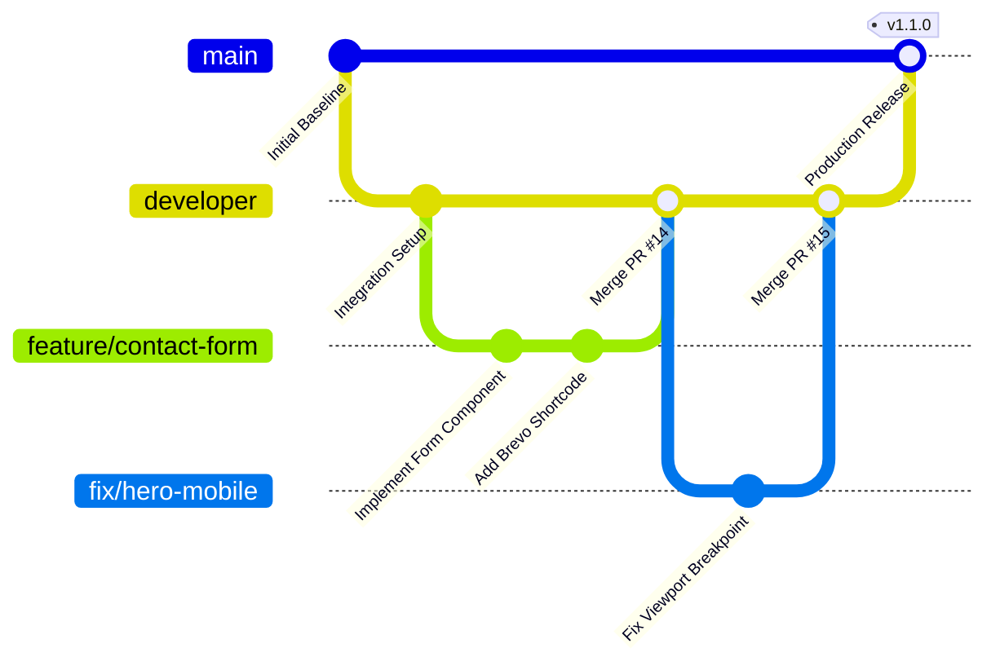

# Lohnour Pro — Multi-Developer GitHub Workflow

This document establishes the official GitHub development and release lifecycle for the **Lohnour Pro** engineering team.

---

## 1. Branch Topology & Responsibilities



| Branch | Purpose | Protection Rules | Allowed Merge Methods |
|---|---|---|---|
| `main` | Production-ready, stable codebase. Deployed to production releases. | Require PR review (1+ approval), require CI checks to pass, disallow force push. | Merge commit or squash merge |
| `developer` | Main staging and integration branch. All active development branches merge here. | Require PR review, require CI checks to pass. | Squash and merge or rebase |
| `feature/*` | Feature development branches created by individual engineers. | None (short-lived, developer-owned). | Merged into `developer` via PR |
| `fix/*` | Bug fixes and non-critical refactoring. | None (short-lived). | Merged into `developer` via PR |
| `hotfix/*` | Critical production incident fixes branched directly from `main`. | Requires Lead approval. | Merged into `main` AND back-merged into `developer` |

---

## 2. Multi-Developer PR Lifecycle

To ensure independent developers do not overwrite each other's work or commit unreviewed artifacts:

### Step 1: Branch Creation
Developers pull the latest `developer` branch before cutting a feature branch:
```bash
git checkout developer
git pull origin developer
git checkout -b feature/my-feature-name
```

### Step 2: Isolated Local Testing
All code must be verified using the local development stack (`docker compose -f docker-compose.local.yml up -d`).

### Step 3: Granular Staging
Developers must stage files selectively by path:
```bash
git add "current source/lohnourpro_wp_theme/functions.php"
git commit -m "feat(theme): add modular contact form shortcode"
```
Never run `git add .`.

### Step 4: Rebase onto Updated Upstream
Before opening a PR or merging, update against the latest `developer` branch to resolve conflicts locally:
```bash
git fetch origin developer
git rebase origin/developer
```

### Step 5: Pull Request & Automated CI
Open a PR targeting `developer`. The GitHub Actions CI pipeline automatically executes:
- **`validate-infrastructure`:** Validates Docker Compose and Caddy syntax.
- **`php-lint`:** Runs PHP syntax checks on all theme files.
- **`secret-scan`:** Verifies no credentials or private keys are tracked.

---

## 3. Production Release Management

1. **Release Preparation:**
   When features on `developer` are verified on staging:
   ```bash
   git checkout main
   git pull origin main
   git merge developer --ff-only
   ```
2. **Semantic Version Tagging:**
   ```bash
   git tag -a v1.1.0 -m "Release v1.1.0: Full Guide Hierarchy & Modular Navigation"
   git push origin main --tags
   ```
3. **Production Deployment Execution:**
   The release is applied to Sam's Oracle VM following [docs/DEPLOYMENT_GUIDE.md](DEPLOYMENT_GUIDE.md).

