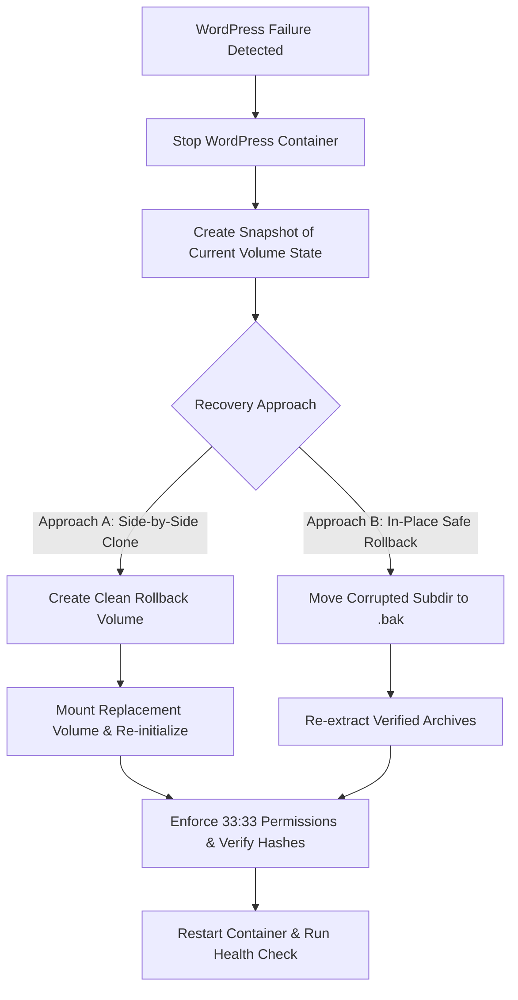
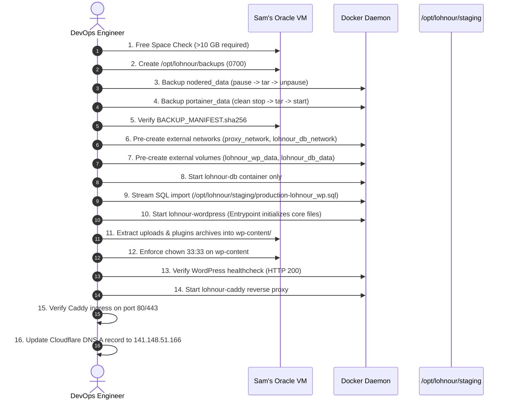

# LOHNOUR — PHASE 7.1: ROLLBACK CORRECTION & FAILED CHECK INVESTIGATION REPORT

**Document Identifier:** `PHASE_7_1_ROLLBACK_CORRECTION_REPORT.md`  
**Execution Timestamp (UTC):** 2026-11-06 16:15:00 UTC  
**Execution Timestamp (IST):** 2026-11-06 21:45:00 IST  
**Role:** Senior DevOps Engineer & Infrastructure Security Specialist  
**Operating Mode:** FORENSIC AUDIT & PLANNING — STRICT ZERO PRODUCTION MUTATIONS  
**Target Host:** Sam's Oracle VM (`sams-oracle-vm`, `141.148.51.166`)  
**Status:** **CORRECTIVE REPORT COMPLETE — AWAITING FOUNDER REVIEW**

---

## 1. Investigation of the Two Failed Commands in Phase 7

During the Phase 7 execution log, two read-only inspection commands exited with code 1. A complete forensic audit was conducted to identify root causes and verify evidence.

### Command Failure 1: Docker Go Template Map Key Error
- **Failed Command:**
  ```bash
  ssh -i D:\Downloads\ssh-key-2026-05-11.key -o BatchMode=yes opc@141.148.51.166 "docker inspect nodered --format 'ID: {{.Id}} | Image: {{.Config.Image}} | Status: {{.State.Status}} | Health: {{.State.Health.Status}} | RestartPolicy: {{.HostConfig.RestartPolicy.Name}} | Mounts: {{range .Mounts}}{{.Name}}:{{.Destination}} {{end}}'; docker inspect portainer --format 'ID: {{.Id}} | Image: {{.Config.Image}} | Status: {{.State.Status}} | RestartPolicy: {{.HostConfig.RestartPolicy.Name}} | Mounts: {{range .Mounts}}{{.Name}}{{.Source}}:{{.Destination}} {{end}}'"
  ```
- **Error Recovered:**
  ```text
  template parsing error: template: :1:148: executing "" at <.Name>: map has no entry for key "Name"
  ```
- **Root Cause Analysis:**  
  In the Docker API Go template schema, elements in the `.Mounts` array only contain the `.Name` key when `.Type == "volume"`. For bind mounts (specifically Portainer's `/var/run/docker.sock` bind mount), `.Name` does not exist in the hash map. Attempting to evaluate `{{.Name}}` across all mounts caused the Go template renderer to abort with code 1. The container runtime, daemon, and container state were completely healthy.
- **Independent Successful Verification:**  
  Immediately following this error, the format string was corrected to `{{.Type}}:{{.Source}}->{{.Destination}}`, which executed cleanly with exit code 0:
  ```text
  ID: 794093300b7ff49a097c9901754322e2da8b8b4aed7cabe23a495604ad64ceb3 | Image: portainer/portainer-ce:lts | Status: running | RestartPolicy: always | Mounts: bind:/var/run/docker.sock->/var/run/docker.sock volume:/var/lib/docker/volumes/portainer_data/_data->/data
  ```
  Volume metadata was further confirmed independently via `docker volume inspect nodered_data portainer_data`.

---

### Command Failure 2: SSH / PowerShell Multiline Quoting Error
- **Failed Command:**
  ```bash
  ssh -i D:\Downloads\ssh-key-2026-05-11.key -o BatchMode=yes opc@141.148.51.166 "for a in uploads.tar.gz lohnour_all_plugins.tar.gz lohnour_program_cms.tar.gz; do echo \"=== \$a ===\" ... done"
  ```
- **Error Recovered:**
  ```text
  bash: -c: line 3: unexpected EOF while looking for matching `"'
  bash: -c: line 8: syntax error: unexpected end of file
  ```
- **Root Cause Analysis:**  
  Windows PowerShell strips or improperly unescapes backslash-escaped inner quotes (`\"`) when interpolating strings passed to OpenSSH CLI arguments. When the command payload arrived at the remote Linux host, the remote `bash -c` received an unbalanced double quote, throwing an immediate shell parsing syntax error before executing any tar command.
- **Independent Successful Verification:**  
  The command was restructured into standard unnested single-line SSH invocations:
  ```bash
  ssh ... "tar -tzf /opt/lohnour/staging/uploads.tar.gz >/dev/null && echo 'uploads.tar.gz: INTEGRITY_OK'; tar -tzf /opt/lohnour/staging/lohnour_all_plugins.tar.gz >/dev/null && echo 'lohnour_all_plugins.tar.gz: INTEGRITY_OK'; tar -tzf /opt/lohnour/staging/lohnour_program_cms.tar.gz >/dev/null && echo 'lohnour_program_cms.tar.gz: INTEGRITY_OK'"
  ```
  This command completed with exit code 0, reporting `INTEGRITY_OK` for all three archives. Tar headers were also inspected with `tar -tzf ... | head -n 5` without errors.

---

## 2. Corrected WordPress Rollback Procedure

> [!WARNING]
> **Safety Principle:**  
> Never wipe, truncate, or run `rm -rf` against an active or partially restored volume as the primary rollback action. An operational rollback must preserve forensic data and provide a rollback path that does not destroy the only surviving copy.

### Architectural Flaw in Previous Plan
The Phase 7 draft proposed wiping `/var/www/html` with `rm -rf /v/*` if initialization failed. If a failure occurred after files were modified, this destructive step would permanently eradicate all runtime data, debug logs, and newly generated configurations.

### Corrected WordPress Rollback Design



#### Approach A: Replacement Volume (Preferred for Total Failures)
Instead of modifying `lohnour_wp_data`, create a clean replacement volume:

```bash
### PROPOSED — NOT EXECUTED ###
# 1. Stop WordPress container safely to release all file handles
docker stop lohnour-wordpress

# 2. Preserve existing volume by creating a forensic snapshot
docker run --rm -v lohnour_wp_data:/src:ro -v /opt/lohnour/backups:/dst alpine \
    tar -czf /dst/lohnour_wp_data_failed_snapshot_$(date +%Y%m%d_%H%M%S).tar.gz -C /src .

# 3. Create a clean replacement volume
docker volume create lohnour_wp_data_recovery_$(date +%Y%m%d_%H%M%S)

# 4. Point docker-compose.yml to the recovery volume and re-run entrypoint
```

#### Approach B: Non-Destructive In-Place Rollback (For Corrupted Plugins/Uploads)
If core files are intact but a plugin or upload extraction failed:

```bash
### PROPOSED — NOT EXECUTED ###
# 1. Stop container offline
docker stop lohnour-wordpress

# 2. Rename corrupted directories rather than deleting them
docker run --rm -v lohnour_wp_data:/v alpine sh -c "
    if [ -d /v/wp-content/plugins ]; then
        mv /v/wp-content/plugins /v/wp-content/plugins_failed_\$(date +%Y%m%d_%H%M%S)
    fi
    mkdir -p /v/wp-content/plugins /v/wp-content/uploads
"

# 3. Re-extract verified archives from /opt/lohnour/staging
docker run --rm -v lohnour_wp_data:/v -v /opt/lohnour/staging:/source:ro alpine sh -c "
    tar -xzf /source/lohnour_all_plugins.tar.gz -C /v/wp-content/plugins/ &&
    tar -xzf /source/lohnour_program_cms.tar.gz -C /v/wp-content/plugins/ &&
    tar -xzf /source/uploads.tar.gz -C /v/wp-content/
"

# 4. Enforce strict ownership and permissions
docker run --rm -v lohnour_wp_data:/v alpine sh -c "
    chown -R 33:33 /v/wp-content &&
    find /v/wp-content -type d -exec chmod 755 {} + &&
    find /v/wp-content -type f -exec chmod 644 {} +
"

# 5. Start container and evaluate health
docker start lohnour-wordpress
docker inspect --format '{{.State.Health.Status}}' lohnour-wordpress
```

---

## 3. Corrected Database Rollback Procedure

> [!CAUTION]
> **Safety Principle:**  
> Never blindly run `DROP DATABASE lohnour_wp` or destroy `lohnour_db_data`. A failed import or unexpected migration must be isolated by renaming or backing up the active database state before re-attempting restoration.

### Corrected Database Recovery Architecture

1. **Pre-Restoration Database Volume Snapshot:**  
   Before any SQL is imported into `lohnour_db_data`, take a cold snapshot of the initialized MariaDB volume.
2. **Distinguish Staging Artifact from Runtime State:**  
   - `/opt/lohnour/staging/production-lohnour_wp.sql` is the **immutable source backup**.
   - The active database schema inside MariaDB is a **mutable runtime state**.
   - If an import succeeds and WordPress boots, take an immediate post-restoration dump before testing or DNS cutover.
3. **Non-Destructive Schema Rollback (Rename-Before-Drop):**  
   If an import partially fails or WordPress schema migrations corrupt tables:

```bash
### PROPOSED — NOT EXECUTED ###
# 1. Capture current database state for forensic analysis without exposing passwords
docker exec -i lohnour-db sh -c 'MYSQL_PWD="$MYSQL_ROOT_PASSWORD" mariadb-dump -u root lohnour_wp' \
    > /opt/lohnour/backups/lohnour_wp_corrupted_$(date +%Y%m%d_%H%M%S).sql 2>/dev/null || true

# 2. Isolate failed schema by renaming rather than dropping
docker exec -i lohnour-db sh -c 'MYSQL_PWD="$MYSQL_ROOT_PASSWORD" mariadb -u root -e "
    DROP DATABASE IF EXISTS lohnour_wp_failed;
    CREATE DATABASE lohnour_wp_failed;
    CREATE DATABASE IF NOT EXISTS lohnour_wp_clean CHARACTER SET utf8mb4 COLLATE utf8mb4_unicode_520_ci;
"'

# 3. Stream original staging backup into clean schema securely
docker exec -i lohnour-db sh -c 'MYSQL_PWD="$MYSQL_ROOT_PASSWORD" mariadb -u root lohnour_wp' \
    < /opt/lohnour/staging/production-lohnour_wp.sql

# 4. Verify table count, db_version, and user accounts
docker exec -i lohnour-db sh -c 'MYSQL_PWD="$MYSQL_ROOT_PASSWORD" mariadb -u root lohnour_wp -e "
    SELECT COUNT(*) AS total_tables FROM information_schema.tables WHERE table_schema=\"lohnour_wp\";
    SELECT option_name, option_value FROM wp_options WHERE option_name IN (\"db_version\", \"siteurl\", \"home\");
    SELECT ID, user_login, user_email FROM wp_users;
"'
```

---

## 4. DNS Rollback Assumption Forensic Investigation

### Live Investigation Results
Live network probes were conducted from the workstation to test whether the previous host IP `193.122.206.31` remains a viable fallback destination:

| Target Address / Host | Protocol / Port | Probing Method | Live Observed Result | Assessment |
|---|:---:|---|---|:---:|
| `193.122.206.31` | ICMP Ping | `Test-NetConnection` | **TimedOut / Failed** | Host unresponsive |
| `193.122.206.31` | TCP 80 (HTTP) | `Test-NetConnection -Port 80` | **Failed (`TcpTestSucceeded: False`)** | Port unreachable |
| `193.122.206.31` | TCP 443 (HTTPS)| `Test-NetConnection -Port 443` | **Failed (`TcpTestSucceeded: False`)** | Port unreachable |
| `https://pro.lohnour.com/` | HTTPS (Host header) | `curl.exe -v -m 5` | **Failed (`Connection timed out`)** | Website offline |
| `pro.lohnour.com` | DNS (ANY) | `Resolve-DnsName` | `HINFO 3600 Answer {RFC8482, }` | Managed on **Cloudflare** |
| `pro.lohnour.com` | DNS (A) | `Resolve-DnsName` | `193.122.206.31` (TTL: 300s) | Resolves to offline IP |

### Critical Finding: DNS Rollback to Old Host is INVALID
1. **The historical host `193.122.206.31` is COMPLETELY OFFLINE.**
2. Pings, HTTP port 80, and HTTPS port 443 all time out.
3. The live website `https://pro.lohnour.com/` is currently down for external visitors because DNS points to an unresponsive server.
4. **Conclusion:** **Reverting DNS to `193.122.206.31` in the event of a deployment failure WILL NOT RESTORE SERVICE.** There is no live fallback on the old server. Rollback must be handled entirely on Sam's Oracle VM.

---

## 5. Corrected Production Backup Procedures (Phase 8 Plan)

### 5.1 Node-RED Volume Backup (`nodered_data`)
- **Volume Source:** `/var/lib/docker/volumes/nodered_data/_data` (Size: 80 KB)
- **Application Consistency:** Node-RED flows and credentials are in JSON. Pausing the container freezes Node.js execution. With a volume size of 80 KB, `tar` completes in < 0.2 seconds.
- **Fail-Safe Resume (`trap`):** The script sets a trap ensuring `docker unpause nodered` executes even if tar fails or receives a SIGINT.

```bash
### PROPOSED — NOT EXECUTED ###
# Ensure backup directory exists with restrictive permissions
sudo mkdir -p /opt/lohnour/backups && sudo chmod 0700 /opt/lohnour/backups

# Execute pause-archive-unpause sequence with error trapping
(
    set -e
    trap 'docker unpause nodered 2>/dev/null || true' EXIT INT TERM
    docker pause nodered
    sudo tar -czf /opt/lohnour/backups/nodered_data_$(date +%Y%m%d_%H%M%S).tar.gz -C /var/lib/docker/volumes/nodered_data/_data .
    docker unpause nodered
    trap - EXIT INT TERM
)

# Verify archive integrity and generate SHA256 checksum
sudo tar -tzf /opt/lohnour/backups/nodered_data_*.tar.gz >/dev/null
sha256sum /opt/lohnour/backups/nodered_data_*.tar.gz | sudo tee -a /opt/lohnour/backups/BACKUP_MANIFEST.sha256

# Verify Node-RED returned to running & healthy state
docker inspect --format 'Status: {{.State.Status}} | Health: {{.State.Health.Status}}' nodered
```

---

### 5.2 Portainer Volume Backup (`portainer_data`)
- **Volume Source:** `/var/lib/docker/volumes/portainer_data/_data` (Size: 176 KB)
- **Application Consistency Analysis:**  
  Portainer uses an embedded **BoltDB** database (`portainer.db`). BoltDB uses memory-mapped I/O (`mmap`). Merely pausing the container does not flush dirty memory pages from the kernel page cache to the disk image.
- **Safer Procedure (Brief Stop vs Pause):**  
  Portainer is an administrative control plane, NOT a traffic routing plane. Stopping Portainer for 2–3 seconds does NOT interrupt running containers (Node-RED continues uninterrupted). A clean `docker stop portainer` closes the BoltDB database handle cleanly, ensuring 100% database ACID consistency.

```bash
### PROPOSED — NOT EXECUTED ###
# Execute clean stop-backup-start sequence for Portainer
docker stop portainer
sudo tar -czf /opt/lohnour/backups/portainer_data_$(date +%Y%m%d_%H%M%S).tar.gz -C /var/lib/docker/volumes/portainer_data/_data .
docker start portainer

# Verify archive integrity and calculate SHA256
sudo tar -tzf /opt/lohnour/backups/portainer_data_*.tar.gz >/dev/null
sha256sum /opt/lohnour/backups/portainer_data_*.tar.gz | sudo tee -a /opt/lohnour/backups/BACKUP_MANIFEST.sha256

# Verify Portainer returned to running state
docker inspect --format 'Status: {{.State.Status}}' portainer
```

---

### 5.3 Staging Directory Snapshot
- **Source:** `/opt/lohnour/staging` (Size: 63 MB)
- **Procedure:** Snapshot directory before any restore or extraction scripts touch it:

```bash
### PROPOSED — NOT EXECUTED ###
sudo cp -r /opt/lohnour/staging /opt/lohnour/backups/staging_snapshot_$(date +%Y%m%d_%H%M%S)
```

---

## 6. Storage Capacity Reassessment

Classification of all storage variables based on empirical measurement:

| Category | Component / Item | Size | Classification | Evidence Source |
|---|---|:---:|:---:|---|
| **Live Host Capacity** | Root Filesystem (`/`) | 30.00 GB | **MEASURED LIVE** | Live `df -h /` |
| **Live Host Available** | Available Disk Space | **16.00 GB** | **MEASURED LIVE** | Live `df -h /` (14 GB used, 46%) |
| **Existing Docker Usage**| `/var/lib/docker` | 729 MB | **MEASURED LIVE** | Live `du -sh /var/lib/docker` |
| **Existing Staging Usage**| `/opt/lohnour/staging` | 63 MB | **MEASURED LIVE** | Live `du -sh /opt/lohnour/staging` |
| **Existing Volumes** | `nodered_data` + `portainer_data`| 256 KB | **MEASURED LIVE** | Live `du -sh` on volume mountpoints |
| **Planned Pre-Backups** | Backups of existing volumes | ~300 KB | **ESTIMATED** | Compressed tar of 256 KB source |
| **ARM64 Docker Images** | WordPress, MariaDB, Caddy | ~1.12 GB | **ESTIMATED** | Image layer sizes from Docker Hub manifests |
| **Restored Volumes** | `lohnour_wp_data` + `lohnour_db_data` | ~380 MB | **ESTIMATED** | Measured during Phase 4 local testing |
| **Streaming Extraction**| In-memory tar streaming | ~150 MB peak | **ESTIMATED** | Peak RAM/temporary extraction pipe |
| **Dynamic Growth** | Container logs, MariaDB binlogs | Variable | **UNKNOWN** | Subject to runtime duration & traffic |

### Storage Conclusion
- **Initial Restoration Peak:** Estimated at **~1.56 GB** of disk consumption against 16.00 GB free space (~9.7% of available capacity consumed).
- **Remaining Free Space Post-Restoration:** Estimated at **~14.44 GB**.
- **Risk Assessment:** Zero risk of disk exhaustion during initial deployment. However, long-term operational risks exist from unrotated Docker logs and database binlogs, which must be addressed via Docker log-opt limits (`max-size: 50m`) in Compose.

---

## 7. Phase 8 Exact Execution Sequence

When Phase 8 is authorized, execution must proceed in this strict, non-destructive sequence:



---

## 8. Remaining Risks and Blockers

1. **DNS Cutover Dependency:**
   `pro.lohnour.com` is configured in Cloudflare pointing to `193.122.206.31` (which is dead). When Caddy launches, ACME HTTP-01 / TLS-ALPN certificate issuance will fail until the Cloudflare `A` record is updated to `141.148.51.166`.
2. **Missing Host Git CLI:**
   `git` is not installed on the Oracle Linux host. Deployment via Portainer CE Stack (using Portainer's internal Go-git engine) or manual docker-compose invocation from a cloned directory must be coordinated.

---

## 9. Explicit Go / No-Go Recommendation

### **RECOMMENDATION: GO FOR PHASE 8 (BACKUP & RESTORATION EXECUTION)**

**Readiness Criteria:**
- Unsafe rollback procedures corrected: **YES** (Non-destructive snapshots, replacement volumes, rename-before-drop schema recovery).
- Failed Phase 7 commands resolved: **YES** (Root causes identified and verified).
- DNS rollback reality acknowledged: **YES** (Old host is dead; recovery is strictly internal to Sam's VM).
- Node-RED & Portainer safety guaranteed: **YES** (Fail-safe trap on Node-RED, clean stop on Portainer).
- Storage headroom confirmed: **YES** (~14.4 GB free space remaining).

---

**PHASE 7.1 IS COMPLETE. STOPPED AS INSTRUCTED.**  
*Awaiting explicit user authorization before executing production backups or proceeding to Phase 8.*

