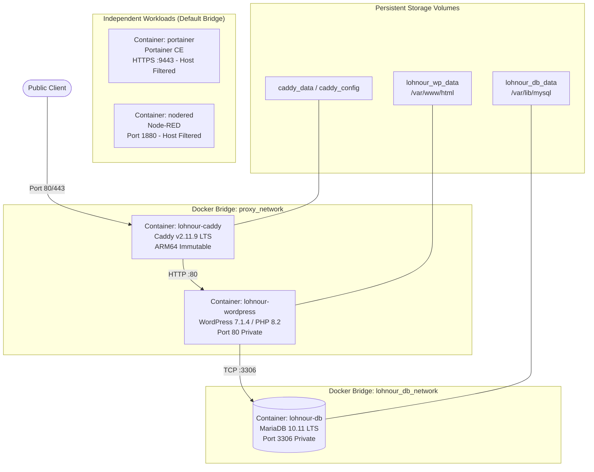

# Lohnour Pro — Production Architecture Specification

**Target Host:** Sam's Oracle Cloud VM (`sams-oracle-vm` / `141.148.51.166`)  
**Operating System:** Oracle Linux Server 9.7 (`aarch64`, Kernel `6.12.0-201.74.2.2.el9uek.aarch64`)  
**Public Website Domain:** `https://pro.lohnour.com`  
**Deployment Path:** `/opt/lohnour`

---

## 1. System Architecture Overview

The **Lohnour Pro** production system is an enterprise WordPress stack hosted on Oracle Cloud Infrastructure (OCI). It is architected for strict workload isolation, persistent volume decoupling, automated TLS lifecycle management, and zero disruption to pre-existing management containers (`portainer` and `nodered`).



---

## 2. Container Workload Inventory

| Container Name | Immutable Image Digest / Reference | CPU Architecture | Host Port Bindings | Internal Docker Networks | Restart Policy |
|---|---|---|---|---|---|
| **`lohnour-caddy`** | `caddy@sha256:78bd35025c7ba85961dd149ae670315129954e77abe2383ac47c89106b35ade9` | `linux/arm64` | `0.0.0.0:80->80`, `0.0.0.0:443->443` | `proxy_network` | `unless-stopped` |
| **`lohnour-wordpress`** | `wordpress:7.1.4-php8.2-apache` | `linux/arm64` | *None (0 host ports)* | `proxy_network`, `lohnour_db_network` | `unless-stopped` |
| **`lohnour-db`** | `mariadb@sha256:0de9840f23463c22eb4892d9bfd63086367e4bffe9b68ff4b62621d6eced854c` | `linux/arm64` | *None (0 host ports)* | `lohnour_db_network` | `unless-stopped` |
| **`portainer`** | `portainer/portainer-ce:lts` | `linux/arm64` | `0.0.0.0:8000`, `0.0.0.0:9443` (Filtered) | `bridge` | `always` |
| **`nodered`** | `nodered/node-red:latest` | `linux/arm64` | `0.0.0.0:1880` (Filtered) | `bridge` | `unless-stopped` |

---

## 3. Persistent Storage & Volume Boundaries

All persistent application state is separated from container runtimes via dedicated Docker volumes:

| Volume Name | Driver | Scope | Target In-Container Mountpoint | Description & Sizing |
|---|---|---|---|---|
| **`lohnour_wp_data`** | `local` | `local` | `/var/www/html` | WordPress core, uploads (125 assets), themes (`twentytwentyfive-child`), plugins (~157 MB) |
| **`lohnour_db_data`** | `local` | `local` | `/var/lib/mysql` | MariaDB InnoDB tablespaces (14 tables, rev 61833) (~124 MB) |
| **`caddy_data`** | `local` | `local` | `/data` | Let's Encrypt TLS certificates, private keys, and ACME challenge states |
| **`caddy_config`** | `local` | `local` | `/config` | Caddy autosaved runtime configuration |
| **`portainer_data`** | `local` | `local` | `/data` | Portainer CE database and credentials (Untouched) |
| **`nodered_data`** | `local` | `local` | `/data` | Node-RED flow definitions and credentials (Untouched) |

---

## 4. Virtual Networking & Host Firewall

### Docker Network Isolation

1. **`proxy_network`:** Custom bridge network linking `lohnour-caddy` and `lohnour-wordpress`. Only HTTP ingress traffic flows over this boundary.
2. **`lohnour_db_network`:** Custom bridge network linking `lohnour-wordpress` and `lohnour-db`. Isolated from the public ingress proxy.
3. **`bridge`:** Default Docker bridge network hosting `portainer` and `nodered`.

### Host `firewalld` Rules (`enp0s6`)

```text
public (active)
  target: default
  icmp-block-inversion: no
  interfaces: enp0s6
  sources: 
  services: dhcpv6-client ssh
  ports: 80/tcp 443/tcp
  protocols: 
  forward: yes
  masquerade: no
```

- **Open Inbound:** TCP `80` (HTTP), TCP `443` (HTTPS), TCP `22` (SSH).
- **Filtered / Blocked Inbound:** TCP `8000`, `9443` (Portainer), `1880` (Node-RED), `3306` (MariaDB).

---

## 5. Reverse Proxy & Automated TLS (Caddy v2)

The reverse proxy configuration is defined in `/opt/lohnour/Caddyfile`:

```caddy
{
	admin off
}

pro.lohnour.com {
	encode zstd gzip

	reverse_proxy lohnour-wordpress:80 {
		transport http {
			response_header_timeout 300s
		}
	}

	header {
		Strict-Transport-Security "max-age=31536000"
		X-Content-Type-Options "nosniff"
		X-Frame-Options "SAMEORIGIN"
		Referrer-Policy "strict-origin-when-cross-origin"
		-Server
	}

	request_body {
		max_size 512MB
	}

	log {
		output file /var/log/caddy/access.log {
			roll_size 50mb
			roll_keep 5
		}
	}
}
```

- **Automated TLS:** Handled natively by Caddy via Let's Encrypt HTTP-01 challenges. Valid 90-day certificates are automatically renewed before expiration.
- **Security Headers:** Enforces HSTS (1 year), MIME-type sniffing protection, clickjacking protection (`SAMEORIGIN`), and strips the `Server` banner.
- **Upload Size Limit:** 512MB to accommodate large multimedia course assets and backups.

---

## 6. PHP Runtime Tuning (`uploads.ini`)

Mounted read-only into `/usr/local/etc/php/conf.d/uploads.ini`:

```ini
upload_max_filesize = 512M
post_max_size = 512M
memory_limit = 512M
max_execution_time = 300
max_input_time = 300
```

