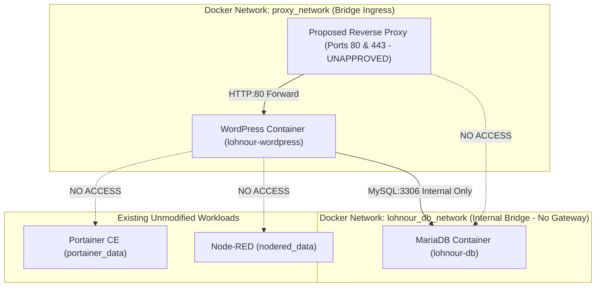

# LOHNOUR PRO — INFRASTRUCTURE SECURITY REVIEW & HARDENING SPECIFICATION

**Document Identifier:** `SECURITY_REVIEW.md`  
**Date:** 2026-11-06  
**Auditor / Role:** Senior DevOps Engineer & Infrastructure Security Auditor  
**Target Environment:** Sam's Oracle VM (Oracle Linux 9.7)  
**Operating Mode:** STRICT READ-ONLY FORENSICS — ZERO DEPLOYMENT MUTATIONS  
**Canonical Documentation Path:** `D:\lohnourpro\docs\SECURITY_REVIEW.md`  
*(Note: Duplicate copies existing in `current source/lohnourpro_wp_theme/my-docs/` are historical theme artifacts and remain untouched).*  
**Status:** **SECURITY REVIEW COMPLETE — HARDENING STRATEGY DEFINED**

---

## 1. Executive Summary

This Security Review provides an exhaustive risk assessment of the infrastructure hosting Lohnour Pro on Sam's Oracle VM. The audit evaluated network exposure, container runtime privileges, boundary isolation, authentication surfaces, and host operating system controls.

The most critical finding of this assessment is the **potential critical risk of public exposure of Portainer CE on TCP port 9443 pending OCI ingress verification, combined with an unmitigated Docker daemon socket mount (`/var/run/docker.sock`)**. While Docker binds `0.0.0.0:9443` on the host, public accessibility depends on the multi-layer perimeter (host listener, OS `firewalld`, OCI Security Lists, and NSGs). If inbound port 9443 is open at the OCI boundary as historically reported, this configuration provides root-equivalent host execution to any actor who compromises Portainer.

This document categorizes all discovered vulnerabilities by severity, analyzes threat vectors, and outlines a multi-tiered security strategy proposed for Founder approval designed to harden the perimeter, isolate workloads, ensure zero credential leakage, and enforce enterprise zero-trust principles prior to any WordPress deployment.

---

## 2. Threat Modeling & Attack Surface Overview

```mermaid
flowchart TD
    Attacker["Public Internet Threat Actors (0.0.0.0/0)"]
    
    subgraph OCI_Firewall["OCI Security List & NSG Ingress Layer (REPORTED — NOT INDEPENDENTLY VERIFIED)"]
        Port22["TCP 22 (SSH) - Reported Permitted (Pending Live Check)"]
        Port80["TCP 80 (HTTP) - Reported Permitted / Host Idle (No Service)"]
        Port443["TCP 443 (HTTPS) - Reported Permitted / Host Idle (No Service)"]
        Port9443["TCP 9443 (Portainer HTTPS) - Reported Permitted (Potential Critical Risk)"]
        Port1880["TCP 1880 (Node-RED) - Reported Dropped at VCN (Unverified)"]
        Port8000["TCP 8000 (Edge Agent) - Reported Dropped at VCN (Unverified)"]
    end

    subgraph HostVM["Sam's Oracle VM (Oracle Linux 9.7)"]
        subgraph DockerDaemon["Docker Engine (Privileged Socket)"]
            Sock[("/var/run/docker.sock")]
        end

        Portainer["Portainer CE Container"]
        NodeRED["Node-RED Container"]
        WP["Proposed WordPress Container"]
        DB["Proposed MariaDB Container"]
    end

    Attacker -.->|Potential Reachability Pending Ingress Check| Port9443
    Port9443 -.-> Portainer
    Portainer -->|Root-Equivalent API Control| Sock
    Sock -->|Container Escape / Host Takeover| HostVM
    
    Attacker -.->|Direct SQL Attack (BLOCKED - Internal Network Only)| DB
    Attacker -.->|Pending Reverse Proxy Selection (Gate 4)| WP
```

The infrastructure exposes two primary perimeter surfaces:
1. **The Application Layer (Ports 80 & 443):** Intended for public web traffic. Currently idle, pending reverse proxy selection and approval (Gate 4).
2. **The Administrative Layer (Ports 22 & 9443):** Intended strictly for operational administration. Port 9443 is bound to `0.0.0.0:9443` on the host; if historical OCI rules permitting `0.0.0.0/0` remain active, it presents an unrestricted public exposure requiring immediate network-level filtering and access hardening (Gate 2).

---

## 3. Security Risks Ranked by Severity

### 3.1 Severity Rating Matrix

> [!IMPORTANT]
> **DISTINCTION BETWEEN HOST BINDING & PUBLIC EXPOSURE (PROVISIONAL RATINGS):**  
> - **Confirmed Host-Level Configuration:** A container port published to `0.0.0.0` confirms that the Docker daemon binds the port across all local IPv4 network interfaces on Sam's Oracle VM (`PREVIOUSLY VERIFIED — RECONFIRM LIVE`).
> - **Unverified External Exposure:** Proven reachability from the public internet depends strictly on multi-layer perimeter filtering: host OS `firewalld` rules, OCI Cloud Security Lists, and OCI Network Security Groups (NSGs). Current OCI ingress configurations remain `REPORTED — NOT INDEPENDENTLY VERIFIED`.
> - **Provisional Ratings:** CVSS v3.1 base scores and severity classifications for network endpoints (SEC-01, SEC-03, SEC-04) are **provisional worst-case evaluations** assuming public ingress is permitted at the cloud boundary. They do **not** represent confirmed internet exploitability without direct external verification. Actual risk findings are preserved to prevent minimizing threats while accurately distinguishing confirmed host telemetry from unverified cloud exposure.

| Risk ID | Vulnerability / Misconfiguration | Affected Component | Severity | CVSS v3.1 | Status Classification |
| :--- | :--- | :--- | :---: | :---: | :---: |
| **SEC-01** | Portainer Web UI Bound to Host (Potential Exposure Pending Ingress Check) | Portainer / OCI Security List | **PROVISIONAL CRITICAL** | **9.8 (Provisional)** | `REPORTED — NOT INDEPENDENTLY VERIFIED` |
| **SEC-02** | Docker Socket Mount with Host Root Privileges | Portainer CE Runtime | **CRITICAL** | **9.0** | `PREVIOUSLY VERIFIED — RECONFIRM LIVE` |
| **SEC-03** | Edge Agent Host Port 8000 Binding (Unverified Perimeter Filtering) | Portainer CE / Host | **PROVISIONAL HIGH** | **7.5 (Provisional)** | `REPORTED — NOT INDEPENDENTLY VERIFIED` |
| **SEC-04** | Node-RED Host Port 1880 Binding (Unverified Perimeter Filtering) | Node-RED Container | **PROVISIONAL MEDIUM** | **6.5 (Provisional)** | `REPORTED — NOT INDEPENDENTLY VERIFIED` |
| **SEC-05** | OS Firewalld & SELinux Policy Desynchronization | Oracle Linux 9.7 OS | **MEDIUM** | **5.5** | `PENDING LIVE VERIFICATION` |
| **SEC-06** | Insecure CLI Password Arguments & Plaintext Secrets | Database Admin / Scripts | **MEDIUM** | **6.0** | `VERIFIED — CURRENT` (Defect identified in documentation) |
| **SEC-07** | Mutable & Unverified Container Image Tags | Deployment Configuration | **MEDIUM** | **5.8** | `BLOCKED` (GATE 3) |

---

### 3.2 Detailed Risk Analysis

#### SEC-01: Portainer Web UI Host Binding (Port 9443) — PROVISIONAL CRITICAL (Pending Ingress Verification)
- **Confirmed Host Configuration:** Portainer binds host port `0.0.0.0:9443 -> 9443/tcp` via Docker port publishing (`PREVIOUSLY VERIFIED — RECONFIRM LIVE`).
- **Unverified External Exposure:** Previous audit notes report that the OCI Security List permits inbound TCP traffic on port `9443` from `0.0.0.0/0` (`REPORTED — NOT INDEPENDENTLY VERIFIED`).
  - *Multi-Layer Perimeter Distinction:* Public internet reachability is governed by multiple independent layers: the host TCP listener (`0.0.0.0:9443`), Docker's published binding, host OS `firewalld` rules, OCI Security Lists, and OCI Network Security Groups (NSGs). Do not infer OCI cloud firewall rules from host firewall output or container bindings alone. A service listening on `0.0.0.0` does NOT prove external reachability without verified cloud security list ingress.
- **Potential Threat Impact (If Exposed):** If the reported OCI ingress rule is active, any public entity could probe and attempt authentication against Portainer. Attack vectors include automated brute-force attacks, exploitation of unauthenticated Portainer CVEs, and Denial of Service.
- **Provisional Classification:** **PROVISIONAL CRITICAL** (CVSS 9.8). Exploitability cannot be confirmed without live external ingress verification, but management-plane access hardening must be enforced under **Gate 2**.

#### SEC-02: Docker Socket Mount with Host Root Privileges — CRITICAL
- **Description:** Portainer is executed with `/var/run/docker.sock:/var/run/docker.sock` mounted directly from the host (`PREVIOUSLY VERIFIED — RECONFIRM LIVE`).
- **Impact:** The Docker daemon socket is equivalent to passwordless root access on the host. Any compromised user account within Portainer, or any remote code execution vulnerability in Portainer, allows an attacker to:
  - Spawn privileged containers with host `/` mounted to `/host`.
  - Read or overwrite any file on Sam's Oracle VM (including `/etc/shadow`, SSH authorized keys, and private data).
  - Inspect, stop, or delete the existing Node-RED container and volumes.
  - Exfiltrate production database secrets and customer data.
- **Risk Level:** **CRITICAL** (CVSS 9.0). Confirmed container runtime misconfiguration.

#### SEC-03: Host Port 8000 Binding — PROVISIONAL HIGH (Pending Ingress Verification)
- **Confirmed Host Configuration:** Portainer binds port `8000` on the host (`0.0.0.0:8000`) (`PREVIOUSLY VERIFIED — RECONFIRM LIVE`). Edge Agent presence is unverified (do not claim Portainer Edge Agent is installed merely because port 8000 is published).
- **Unverified External Exposure:** Past notes report port 8000 dropped at the OCI VCN boundary (`REPORTED — NOT INDEPENDENTLY VERIFIED`). Host-level listening exposes an unnecessary endpoint if perimeter filtering shifts.
- **Provisional Classification:** **PROVISIONAL HIGH** (CVSS 7.5).

#### SEC-04: Node-RED Host Port 1880 Binding — PROVISIONAL MEDIUM (Pending Ingress Verification)
- **Confirmed Host Configuration:** The Node-RED container binds `0.0.0.0:1880` on the host (`PREVIOUSLY VERIFIED — RECONFIRM LIVE`).
- **Unverified External Exposure:** While previous audit notes report that the OCI Security List drops public inbound packets on port 1880, this perimeter protection is `REPORTED — NOT INDEPENDENTLY VERIFIED`. Any accidental security list change or internal lateral movement would immediately expose Node-RED flows and credentials to the network.
- **Provisional Classification:** **PROVISIONAL MEDIUM** (CVSS 6.5).

#### SEC-05: OS Firewalld & SELinux Policy Desynchronization — `MEDIUM`
- **Description:** Oracle Linux 9.7 utilizes `firewalld` and `SELinux` in enforcing mode by default.
  - Docker configures its own `iptables`/`nftables` chains, but firewalld default drop zones can intercept external packets destined for Docker ports.
  - SELinux prevents unconfined container processes from accessing host filesystem directories unless labelled with `:z` (shared) or `:Z` (private) flags.
- **Risk Level:** **MEDIUM**. Failure to account for SELinux and firewalld will cause silent network drops or permission-denied container crashes during deployment.

#### SEC-06: Insecure CLI Password Arguments & Credential Leakage — `MEDIUM`
- **Description:** Passing database passwords directly via command-line arguments (such as `-p"${DB_PASSWORD}"` or `-p"secret"`) is a severe operational hazard.
  - **Process Table Exposure:** Any local user or monitoring process executing `ps aux` or `ps -ef` can inspect the full command line and view the plaintext database password.
  - **Procfs Leakage:** The password is recorded in `/proc/<pid>/cmdline`.
  - **Shell History Leakage:** Commands executed interactively are logged in `.bash_history`.
- **Remediation Standard:** Passing passwords via command-line flags is strictly forbidden. Credentials must be supplied via a temporary secured client option file (`--defaults-extra-file=/path/to/client.cnf` with file mode `0600`) mounted or copied into the container runtime.

#### SEC-07: Mutable & Unverified Container Image Tags — `MEDIUM`
- **Description:** Referencing rolling tags such as `:latest` or unverified minor tags introduces supply-chain vulnerabilities, unreproducible builds, and silent breaking changes upon container recreation.
- **Remediation Standard:** All production images must be pinned to explicit, verified version tags. Where absolute immutability is required, **Image Digest Pinning** (`image@sha256:<hash>`) must be implemented to protect against upstream registry tag overwrites.

---

## 4. Portainer Hardening & Access Strategy Proposed for Founder Approval

To remediate **SEC-01** and **SEC-02**, Portainer access must be immediately decoupled from the public internet. Two strategies are presented for Founder sign-off:

```mermaid
graph LR
    subgraph Option1["Option 1: SSH Bastion Tunnel (RECOMMENDED)"]
        Admin1["Founder / Admin"] -->|Encrypted SSH (Port 22)| HostSSH["Host SSH Daemon"]
        HostSSH -->|Local Forward L:9443| Portainer1["Portainer (127.0.0.1:9443)"]
        Firewall1["OCI Firewall: 9443 CLOSED to Public"]
    end

    subgraph Option2["Option 2: OCI Security List IP Allowlist"]
        Admin2["Founder Static IP"] -->|Direct HTTPS| Portainer2["Portainer (Port 9443)"]
        Firewall2["OCI Firewall: 9443 PERMITTED ONLY for Founder IP/32"]
    end
```

### Strategy Comparison & Recommendations

| Parameter | Option 1: SSH Local Port Forwarding (Recommended) | Option 2: OCI IP Allowlisting |
| :--- | :--- | :--- |
| **Security Posture** | **Maximum (Zero Public Ingress)** | High (Perimeter filtered) |
| **OCI Security List Rule** | **DELETE rule for port 9443** | Restrict 9443 to `Founder_IP/32` |
| **Client Requirement** | Standard SSH Client (`ssh -L`) | Static IP required |
| **Implementation Complexity**| **Immediate (0 cost, 5 minutes)** | Immediate (requires static IP) |
| **Operational Impact** | Portainer accessed via `https://localhost:9443` | Portainer accessed via `https://<VM_IP>:9443` |

### Recommended Action Plan (Option 1):
1. **Revoke Inbound 9443 in OCI Console (`PENDING FOUNDER APPROVAL`):** Remove the ingress rule permitting `0.0.0.0/0` on TCP 9443. Do not modify OCI rules prior to approval.
2. **Establish Access via SSH Tunnel:**
   ```bash
   ssh -i ~/.ssh/oracle_key.key -L 9443:localhost:9443 opc@141.148.51.166
   ```
   *(Note: Target IP `141.148.51.166` is the previously verified baseline public IP; live reconfirmation in OCI Console is required prior to cutover. Current DNS does NOT point to this IP).*  
   Admin accesses Portainer securely in their local browser at `https://localhost:9443`.
3. **Internal Portainer Configuration:**
   - Enforce an administrative passphrase of at least 24 random characters.
   - Set the administrative session timeout to 30 minutes.
   - Disable the publication of Edge Agent port 8000.

---

## 5. Workload Isolation: Protecting Node-RED & Portainer

To ensure that the WordPress production stack cannot interfere with or compromise existing workloads:



### Strict Isolation Boundaries:
1. **Network Segregation (`PROPOSED`):**
   - `lohnour_db_network`: Private Docker bridge network created with `internal: true`. No external gateway or public routing. MariaDB binds **only** to this internal network and exposes **zero** published ports on the host.
   - `proxy_network`: Standard bridge network connecting the Reverse Proxy and the WordPress application container.
   - **Zero Cross-Contamination:** Node-RED and Portainer are never connected to `lohnour_db_network` or `proxy_network`.
2. **Filesystem & Volume Isolation (`PROPOSED`):**
   - WordPress data is strictly isolated in proposed named volume `lohnour_wp_data`.
   - MariaDB production data is strictly isolated in proposed named volume `lohnour_db_data` (mounted by production Compose service `db`; initialized under Gate 7).
   - Staging database restore verification drills (Gate 6 — Stage 3) strictly utilize dedicated staging volume `lohnour_db_staging_data` to ensure zero mutation or collision with the production database volume `lohnour_db_data`.
   - Host volumes for existing workloads (`portainer_data`, `nodered_data`) are completely isolated.
3. **Resource Quotas & Allocation (`PROPOSED — NOT APPROVED — NOT DEPLOYED`):**
   - Proposed CPU limits:
     - WordPress: Max `1.00 OCPU`.
     - MariaDB: Max `1.00 OCPU`.
     - Reverse Proxy (only if selected): Max `0.25 OCPU`.
     - Total Application CPU Limit: **2.25 OCPU** (leaves 1.75 OCPU nominal capacity unassigned).
   - If no Reverse Proxy is selected: WordPress + MariaDB limits total **2.00 OCPU** (leaves 2.00 OCPU nominal capacity unassigned).
   - *Mandatory Technical Resource Clarifications:*
     - **CPU Limits:** Define maximum CPU capacity a container can consume under CFS; they are not guaranteed allocations, nor do they mean continuous consumption.
     - **CPU Reservations:** Distinct from limits. No reservations are verified or approved; **CPU reservations remain unspecified**.
     - **Actual Usage:** Actual CPU usage is not established by this documentation task; proposed limits are not measured usage, and unused capacity is not dedicated to existing services.
     - **Existing Services & Contention:** Portainer and Node-RED are already active; their usage and limits are unestablished. Nominal unassigned capacity (1.75 OCPU, or 2.00 OCPU without proxy) is shared with existing services and host OS. This allocation does **not** guarantee headroom or prevent CPU contention.

4. **Storage & Capacity Verification (`PENDING VERIFICATION`):**
   - Host root filesystem was previously observed as 30 GB total (~16 GB available free space).
   - Docker Root Dir is unconfirmed and available disk space must be measured via `df -h` before staging.
   - Sizing must account for database growth, temporary archives, local backups, and rollback space.
   - Storage feasibility remains **`PENDING VERIFICATION`**.

---

## 6. Database Hardening & Credential Standards

The production database must adhere to strict security parameters:

1. **No Host Port Binding (`PROPOSED`):**
   - Under no circumstances will port `3306` or `33060` be published to the host (`ports:` block omitted from the database service).
   - Database is accessible **exclusively** by the WordPress container via Docker internal DNS (`db:3306`).
2. **Secure Credential Injection & Delivery Architecture (`VERIFIED — ISOLATED TEST ONLY — PHASE 7.4`):**
   - Command-line arguments containing `-p<password>` are strictly prohibited.
   - **Containerized Option File Pattern (`VERIFIED — ISOLATED TEST ONLY — PHASE 7.4`):**
     - The database client executing inside the container cannot directly read a host-only path.
     - *Procedure:*
       1. The operator creates a temporary client option file on the host within a private `0700` directory (`mktemp -d /opt/lohnour/staging/db_cnf.XXXXXX`) with file permissions `0600`, generating credentials via pure bash parameter expansion escaping (zero subshells, zero `ps aux` command-line leaks).
       2. The file is copied into the database container's temporary storage via `docker cp "${CLIENT_CNF}" lohnour-db-init:/tmp/client.cnf`.
       3. Permissions inside the container are enforced via `docker exec lohnour-db-init chmod 600 /tmp/client.cnf`.
       4. The client executes commands referencing `--defaults-extra-file=/tmp/client.cnf` as the first argument.
       5. *Cleanup & Limitations:* Immediately following execution or upon abort, an `EXIT INT TERM` trap unlinks the temporary file inside the container (`docker exec lohnour-db-init rm -f /tmp/client.cnf`) and removes the host directory (`rm -rf "${CLIENT_CNF_DIR}"`). Schema verification occurs BEFORE cleanup. Verified 100% across 9 password categories in MariaDB 10.11.19 in Phase 7.4.
     > [!WARNING]
     > **ERASURE LIMITATION & UNTESTED STATUS:** While `rm` unlinks the file from filesystem directory structures, it does **NOT** guarantee physical erasure from container writable layers, underlying copy-on-write (CoW) storage drivers (such as overlay2), host block storage, or Docker volume backups. This pattern is strictly `PROPOSED — NOT TESTED` and must be validated in an isolated staging test environment before production use.
3. **Database User Privileges (`PROPOSED`):**
   - Dedicated, unprivileged user `lohnour_user` restricted to database `lohnour_wp.*`. Global administrative privileges (`SUPER`, `GRANT OPTION`, `FILE`) must be denied.

---

## 7. Web Application & Reverse Proxy Hardening Specification

> [!NOTE]
> **REVERSE PROXY STATUS: `PROPOSED — NOT APPROVED`**  
> The specific reverse proxy software (Nginx Proxy Manager, Caddy, Traefik, Standalone Nginx, or Cloudflare Tunnel) is subject to Founder decision. Regardless of technology chosen, the following transport security parameters are mandatory.

### 7.1 TLS/SSL Configuration Standards
- **Protocols:** Enforce **TLSv1.2** and **TLSv1.3** only. Explicitly disable SSLv3, TLSv1.0, and TLSv1.1.
- **HSTS (HTTP Strict Transport Security):**
  - Standard HSTS enabled with a minimum duration of 1 year (`max-age=31536000`).
  - **Preload & Subdomain Restriction:** Do **NOT** mandate HSTS preload or `includeSubDomains` before subdomain readiness and domain stability are verified. Preloading is virtually irreversible and risks bricking access to unconfigured subdomains.
- **HTTP to HTTPS Redirection:** Mandatory 301 permanent redirect on port 80.

### 7.2 HTTP Security Headers
The following security headers must be injected at the ingress edge:
```text
X-Content-Type-Options: "nosniff"
X-Frame-Options: "SAMEORIGIN"
Referrer-Policy: "strict-origin-when-cross-origin"
Permissions-Policy: "geolocation=(), microphone=(), camera=()"
```
*(Note: Obsolete `X-XSS-Protection` is explicitly removed as modern browsers have deprecated or disabled it, and it introduces client-side security side-channels. Cross-site scripting defenses are enforced via proper input sanitization and Content-Security-Policy).*

### 7.3 Cloudflare Origin Security (If Cloudflare DNS Active)
- **SSL/TLS Encryption Mode:** Set to **Full (Strict)** in Cloudflare dashboard to ensure end-to-end encryption.
- **Authenticated Origin Pulls:** Recommended to ensure the VM only accepts HTTPS requests originating from Cloudflare IP addresses.

---

## 8. Operating System Security (Oracle Linux 9.7)

Oracle Linux 9.7 incorporates security mechanisms that must be harmonized with Docker:

1. **Firewalld Hardening (`UNKNOWN — REQUIRES STAGE 0 VERIFICATION`):**
   - *Governance Requirement:* Any host firewall modification is strictly approval-gated (Gate 2).
   - Check if `firewalld` is active: `systemctl is-active firewalld`.
   - If active and approved, ensure public zone explicitly permits HTTP and HTTPS:
     ```bash
     sudo firewall-cmd --permanent --zone=public --add-service=http
     sudo firewall-cmd --permanent --zone=public --add-service=https
     sudo firewall-cmd --reload
     ```
   - Verify that port 9443 and port 1880 are **NOT** permitted in firewalld public zone.
2. **SELinux Policy Alignment (`UNKNOWN — REQUIRES LIVE VERIFICATION`):**
   - Check SELinux status: `getenforce`.
   - **Nuanced `:z` Application:** Do **NOT** apply `:z` blindly to every mount.
     - Relabeling with `:z` (shared SELinux label `svirt_sandbox_file_t`) or `:Z` (private) must ONLY be applied to specific application host bind mounts (such as staged `uploads.ini:ro,z`) if SELinux is in `Enforcing` mode.
     - Do **NOT** apply `:z` to system directories (`/etc`, `/var`, `/run`, `/var/run/docker.sock`). Relabeling host system directories corrupts host SELinux policy and introduces host security risks.
     - Named Docker volumes (`lohnour_wp_data`, `lohnour_db_data`, `lohnour_db_staging_data`, `portainer_data`, `nodered_data`) are managed natively by Docker within its configured Docker Root Dir (actual mountpoints must be confirmed via `docker volume inspect <name>` and must not be assumed to reside at `/var/lib/docker/volumes/...`). Named volumes do NOT require `:z` relabeling.
3. **Host Access via SSH (`PENDING LIVE VERIFICATION`):**
   - Whether password authentication is disabled in `/etc/ssh/sshd_config` (`PasswordAuthentication no`) is **`PENDING LIVE VERIFICATION`**.
   - Whether root login is disabled (`PermitRootLogin no` or `prohibit-password`) is **`PENDING LIVE VERIFICATION`**.
   - SSH access is reported as restricted to authorized public keys, but the live server configuration has not been directly inspected.
